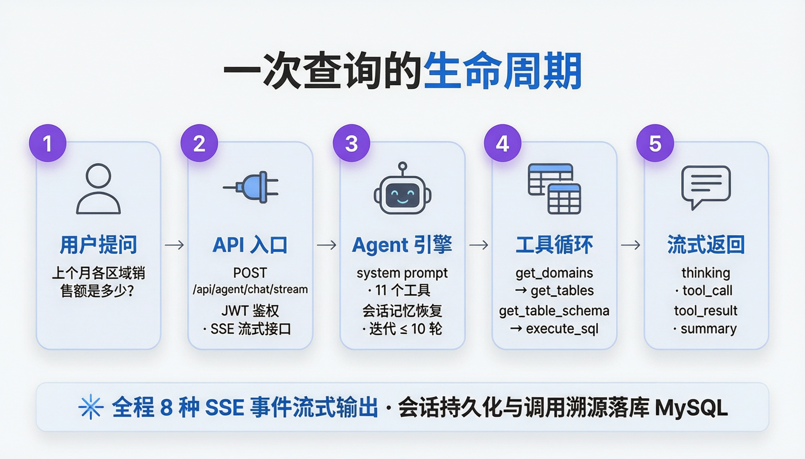
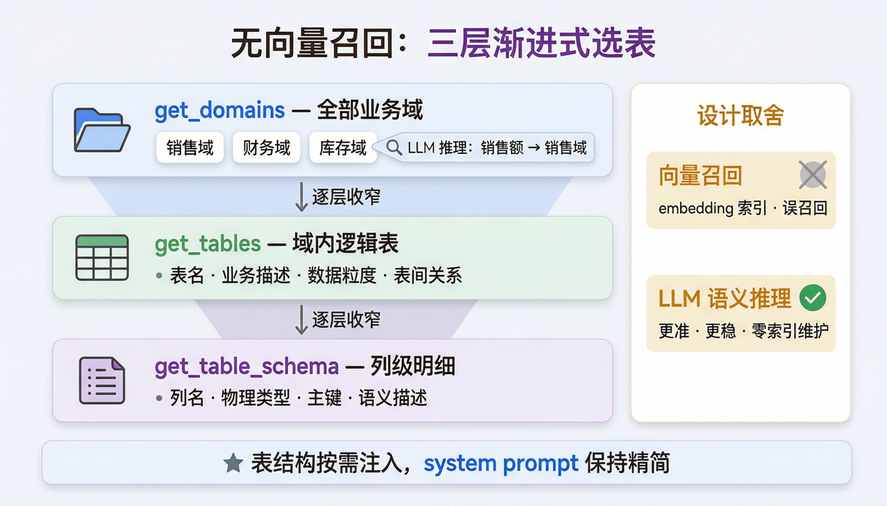
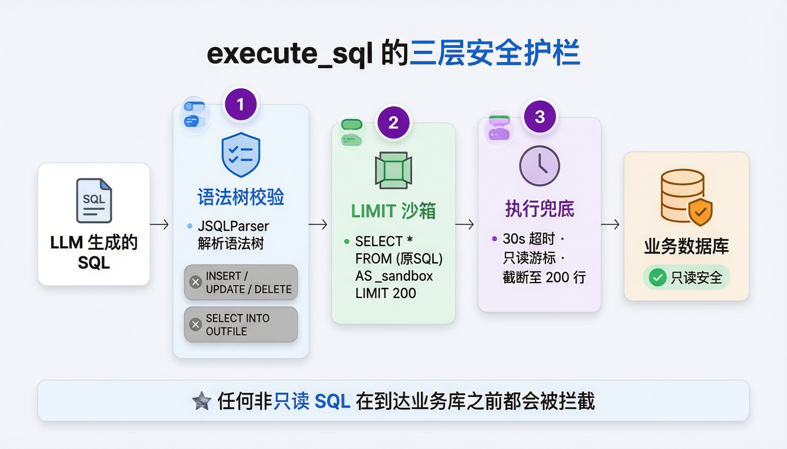
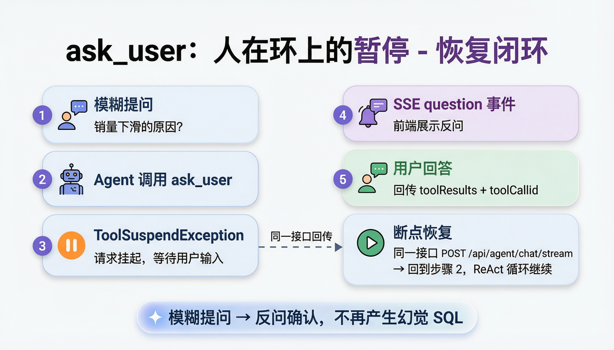

# 拆解一个 Text-to-SQL Agent：从用户提问到数据返回的完整链路

> 本文以开源项目 [Data Agent](https://github.com/MaloneTalk/DataAgent) 的真实代码为蓝本，完整拆解一次"用户用中文提问 → Agent 理解意图 → 选表 → 生成 SQL → 执行 → 流式回答"的全过程，重点讲清楚每一步的**实现细节**与**设计取舍**。所有代码均摘自项目源码（Java / Spring Boot 4），文末附关键文件索引。

用户在聊天框输入 *"上个月各区域销售额是多少？"*，按下回车之后，后端发生的事情可以概括为一条主链路：



---

## 1. 入口：一个 SSE 接口扛起所有对话

入口非常克制，只有一个核心接口（`AgentController.java`）：
```java
@PostMapping(value = "/chat/stream", produces = MediaType.TEXT_EVENT_STREAM_VALUE)
public Flux<ServerSentEvent<ChatStreamEvent>> chatStream(
        @Valid @RequestBody ChatRequest request) {
    // 在 Reactor 切换线程之前取出 userId
    int userId = userContextHolder.checkAndGet().userId();
    return agentService.chatStream(
                    userId, request.sessionId(), request.message(),
                    request.toolResults(), request.datasourceId())
            .map(event -> ServerSentEvent.<ChatStreamEvent>builder()
                    .event(event.type().getCode())
                    .data(event)
                    .build());
}
```

请求体 `ChatRequest` 只有四个字段，值得注意的不是 `message`，而是另外两个：
```java
public record ChatRequest(
        @NotBlank String sessionId,      // 会话 ID，必填
        String message,                  // 用户输入
        List<ToolResultInput> toolResults, // 工具结果回传（后面 ask_user 会用到）
        Integer datasourceId) {          // 会话绑定的查询数据源
    public record ToolResultInput(String toolCallId, String toolName, String output) {}
}
```

**鉴权** 由 `AuthInterceptor` 完成：解析 `Authorization: Bearer <JWT>` 得到 userId，校验用户存在且未禁用后放入 `ThreadLocal`（`UserContextHolder`）。注意代码注释里那句 *"Read userId before Reactor switches threads"*——SSE + Reactor 异步链路里，ThreadLocal 在切换线程后就失效了，所以必须在进入响应式流之前把 userId"抄"出来，这是一个容易被忽略的工程细节。

**SSE 事件协议** 定义在 `ChatStreamEventType` 枚举中，一共 8 种：

| 事件 | 含义 |
| --- | --- |
| `thinking` | 模型思考过程（思维链）增量文本 |
| `text` | 正文增量文本 |
| `tool_call` | Agent 决定调用某工具（含工具名 + 参数） |
| `tool_result` | 工具执行结果 |
| `question` | Agent 反问用户（配合 `ask_user` 工具） |
| `report` | 报表生成结果 |
| `summary` | 最终回答 |
| `error` | 错误 |

前端拿到这条事件流，就能把"AI 正在查库 → 查到了什么 → 正在总结"的全过程实时画在界面上，而不是让用户盯着一个转圈等 30 秒。

---

## 2. 引擎：一个"小而准"的 ReAct 循环

核心在 `AgentService`。它基于 [agentscope-java](https://github.com/agentscope-ai) 的 `ReActAgent` 搭建，每次用户提问都会构建一个 Agent 实例：
```java
private ReActAgent createAgent(ToolCallContext toolCallContext) {
    ToolExecutionContext context =
            ToolExecutionContext.builder().register(toolCallContext).build();
    return ReActAgent.builder()
            .name("DataAgent")
            .sysPrompt(systemPrompt())
            .model(modelFactory.getInstance(modelProperties))
            .toolkit(toolkit)                    // 10 个工具，启动时注册一次
            .toolExecutionContext(context)       // sessionId/userId 注入工具
            .skillBox(skillBox)                  // Skill 系统挂载点
            .memory(new InMemoryMemory())        // 本轮工作记忆
            .maxIters(10)                        // 最多推理 10 轮
            .enablePendingToolRecovery(true)     // 支持中断后恢复
            .build();
}
```

几个设计点值得展开：

**（1）System prompt 刻意保持"小而准"。** 很多人喜欢把业务知识全部塞进 system prompt，这个项目没有这么做。系统提示词只做一件事——锚定时间感知：
```java
private String systemPrompt() {
    LocalDate today = LocalDate.now(DEFAULT_ZONE);
    return """
            你是一个数据助手，可以帮助用户查询数据库中的数据。
            当前时区是 Asia/Shanghai。
            今天是 %s，昨天是 %s，明天是 %s。
            当用户提到今天、昨天、明天、上周、本周等相对日期时，
            必须先按以上当前日期换算成具体日期。
            查询日期、星期、节假日、调休或日期差时，优先使用 get_date_info 工具。
            """.formatted(today, today.minusDays(1), today.plusDays(1));
}
```

为什么日期要写进 prompt？因为 *"上个月销售额"* 里的"上个月"必须先被换算成 `2026-09-01 ~ 2026-09-30` 这样的具体区间，模型才可能写出正确的 SQL。而日期是运行时变量，用 `.formatted()` 每次请求现算。**表结构、指标口径这些"重"知识则完全不走 system prompt，而是通过工具按需获取** ——这是后面语义层的核心设计。

**（2）记忆分两层。** `InMemoryMemory` 是本轮对话的工作内存，真正跨请求的记忆靠 `agent.loadIfExists(session, sessionId)` 从 MySQL 恢复历史消息，流结束后再 `agent.saveTo(session, sessionId)` 写回。也就是说：**每个 sessionId 拥有持久化的完整对话历史，Agent 天然支持多轮追问**（"那按季度拆一下呢？"）。

**（3）maxIters(10) 是护栏。** ReAct 循环理论上可能无限打转（模型反复试错 SQL），10 轮的上限保证资源可控。对绝大多数查数场景，实际路径是 3~5 轮。

**（4）流式贯穿始终。** `agent.stream(userMsg, streamOptions)` 返回 `Flux<Event>`，`StreamOptions` 指定只订阅 `REASONING`（推理）、`TOOL_RESULT`（工具结果）、`SUMMARY`（总结）三类事件，并开启 `incremental(true)` 增量输出。

**（5）事件翻译：一条策略链，特殊工具各自认领。** `EventConverter` 把内部事件翻译成第 1 节的 8 种 SSE 事件：`REASONING` → `thinking`/`text`、`SUMMARY` → `summary` 都是直译；但 `tool_result` 的去向由一条 `ToolResultHandler` 策略链决定，每个 Handler 用 `supports()` 认领自己能处理的结果——`AskUserToolResultHandler` 认领 `block.isSuspended()` 且工具名为 `ask_user` 的结果，翻译成 `question` 事件（第 7 节的挂起就是它接住的）；`GenerateReportToolResultHandler` 认领 `generate_report` 且以成功前缀开头的结果，查出报表内容翻译成 `report` 事件；都不认领时走默认的 `tool_result`。新增一个需要特殊前端展示的工具 = 加一个 Handler，转换层零改动。

这里还藏着一个流式协议的坑：REASONING 事件里工具调用参数是逐 token 生成的，流式中间态的 `ToolUseBlock` 拿到的是残缺 JSON。`EventConverter` 跳过流式中间的 ToolUseBlock，只在 isLast 那一刻发出参数完整的 `tool_call`——否则前端会收到半截参数。

**（6）Toolkit 全景：10 个工具。** 按典型调用顺序：

| # | 工具 | 职责 | 备注 |
| --- | --- | --- | --- |
| 1 | `get_domains` | 列出全部业务域 | 选表第一步 |
| 2 | `get_tables` | 按域列出逻辑表 | 返回末尾附指标口径提醒（第 4 节） |
| 3 | `get_table_schema` | 取列级明细 | 列名 / 类型 / 主键 / 语义描述 |
| 4 | `get_metric_caliber` | 查指标口径 | `hint` 可直传用户问题原文 |
| 5 | `get_date_info` | 日期与节假日计算 | 相对日期换算的兜底 |
| 6 | `execute_sql` | 只读执行 SQL | 三层护栏，见第 5 节 |
| 7 | `execute_python` | 子进程跑 Python 统计 | `-I` 沙箱 / 30s 强杀 / 并发 5，见第 6 节 |
| 8 | `export_table` | 导出查询结果为 CSV | 上限 10000 行 |
| 9 | `generate_report` | 生成报表 | 成功时产出 `report` 事件 |
| 10 | `ask_user` | 反问用户 | 抛 `ToolSuspendException` 挂起，见第 7 节 |

---

## 3. 意图识别与选表：用"模型推理"替代"向量检索"

这是整个项目最值得聊的设计决策。传统 Text-to-SQL 方案的标配是 **embedding + 向量库**：把几百张表的名和注释向量化，用户问题也向量化，算余弦相似度召回 Top-K 张表。这条路的问题：要维护 embedding 模型和索引、存在误召回/漏召回、表多了之后召回质量抖动。

Data Agent 的做法是：**不引入任何向量检索，把"选表"变成一次 LLM 工具调用**。依靠三个渐进式工具：



**第一层：`get_domains`** —— 列出所有业务域（名称 + 描述），工具描述里直接告诉模型 *"Call this tool first to choose the most relevant domains before querying tables"*。模型看到"销售额"问题，会推理出它属于「销售域」而不是「财务域」。

**第二层：`get_tables(domains)`** —— 按域过滤，返回语义层登记的表：表名、所属域、业务描述、**数据粒度（一行代表什么）**、已启用的表间关系。实现直查元数据库：

```java
return ToolResultBlock.text(
        JsonUtils.getJsonCodec().toJson(
                tableSemanticService.listMergedTablesByDomains(
                        dataSource.getId(), domains))
        + ToolCallConstants.METRIC_CALIBER_REMINDER);
```

**第三层：`get_table_schema(table_name)`** —— 拿到目标表的列级信息：列名、物理类型、语义类型、主键、索引提示、业务描述。

信息像漏斗一样逐层收窄：**全域 → 域内表 → 表内列**。每一步的"判断"都由 LLM 的语义推理完成（"销售额"属于销售域，这是理解，不是相似度计算），而每一步的"数据"都来自人工在语义管理页面维护的元数据。这就是 README 所说的 *"无向量召回"*：零 embedding 依赖、零索引维护，召回边界清晰可解释——模型调了 `get_tables(domains=["销售"])`，你能明确知道它为什么查这些表。

---

## 4. 指标口径：一个"提醒时机"的提示词工程细节

语义层里还有一类特殊资产——**指标（Metric）**：销售流水、GMV 这类口径敏感的业务概念，每个指标登记了度量表达式、过滤条件、时间字段、单位、倍率、币种。

难点在于：模型怎么知道"该去查口径了"？写进 system prompt？实测容易被忽略。这个项目给出了一个很巧的解法（`ToolCallConstants.java`，注释本身就是教材）：

```java
/**
* 追加在 get_tables / get_table_schema 的返回结果末尾。模型写 SQL 前基本必看表结构,
* 在那个时机提醒「先确认指标口径」比在 system prompt 里说更准——此时它正准备动笔。
* 数据源没定义任何指标时,get_metric_caliber 会回「未定义」,模型自然跳过。
*/
public static final String METRIC_CALIBER_REMINDER = """
        If the question involves a business metric, call get_metric_caliber to confirm its \
        caliber before writing SQL.
        """;
```

**提醒不是放在模型"出发前"，而是放在它"正准备动笔"的那一刻**——每次返回表结构时附上这句话。此时模型的注意力正集中在表和指标上，遵循率远高于 system prompt 里的一条孤立规则。这是一个可复用的提示词工程模式：**关键指令的注入时机，应该贴近它被需要的上下文**。

另外 `get_metric_caliber` 的参数设计也很务实——`hint` 允许直接传用户问题原文（"上个月的GMV是多少"），匹配器内部扫描已知指标名和别名，省得模型再"蒸馏"关键词。

---

## 5. SQL 生成与执行：三层护栏保护业务库

模型写完 SQL 后调用 `execute_sql`。让 LLM 生成的 SQL 直接碰生产库显然危险，`SqlExecutor` 上了三层护栏：



**护栏一：语法树级只读校验。** 不是用正则/关键字黑名单（`//` 注释、编码绕过都能骗过），而是用 **JSQLParser 把 SQL 解析成语法树**再检查：

```java
String validateAndTransform(String sql) {
    Select select = parseAllowedSelect(sql);   // 解析失败或非 SELECT 直接拒绝
    String safeSql = trimTrailingSemicolon(sql);
    // inject LIMIT if absent, to prevent full table scans
    if (!hasLimit(select)) {
        return "SELECT * FROM (" + safeSql + ") AS _sandbox LIMIT " + MAX_ROWS;
    }
    return safeSql;
}
```

校验逻辑（`parseAllowedSelect` + `validateSelectBody`）会：拒绝一切非 `Select` 语句（INSERT/UPDATE/DELETE/DDL）；**递归遍历** WITH 子句、UNION 集合、括号子查询，封杀 `SELECT ... INTO OUTFILE / DUMPFILE / 新表` 这类"披着 SELECT 外衣"的写库操作。正则防不住的绕过手法，语法树层全部显式拒绝。

**护栏二：自动 LIMIT 沙箱。** 没有 LIMIT 的 SQL 被包一层子查询，强制 `LIMIT 200`（`MAX_ROWS` 常量），防止 `SELECT *` 全表扫描拖垮业务库。

**护栏三：执行期兜底。** `PreparedStatement` + `setQueryTimeout(30)` 秒级超时；`TYPE_FORWARD_ONLY` 只读游标 + `fetchSize(200)`；结果集最多读 200 行就标记 `truncated=true` 停止拉取，然后格式化成紧凑文本回灌给模型：

```
Query result (total 35 rows):
Columns: [region, sales]
Row 1: {region=华东, sales=120000}
...
```

先说清楚**数据源是怎么流转到 SQL 的**：`ToolCallContext` 里只有 `sessionId` 和 `userId`，并不携带数据源——用户选择数据源时，后端只把 `(sessionId, datasourceId)` 绑定关系落库（第 8 节的 `INSERT IGNORE` 归属声明）；`execute_sql` 执行时再按 `sessionId` 反查出绑定的数据源。会话级绑定意味着同一会话的所有查询共享一个库，换库就是重新绑定。

拿到了 `datasourceId`，就轮到 `DynamicDataSourceManager`：数据源按 `datasourceId` 缓存 HikariCP 连接池（`ConcurrentHashMap.computeIfAbsent`），驱动缺失时 Hikari 会抛 `NoClassDefFoundError`——它是 **Error 不是 Exception**，会绕过 `catch (Exception)`。代码里专门补了 `catch (Error e)` 并转译成"请在 pom.xml 添加依赖 xxx"的可操作提示：

```java
} catch (RuntimeException e) {
    throw translateInitializationFailure(type, e);
} catch (Error e) {
    // 驱动依赖缺失时 JVM 抛的是 NoClassDefFoundError（Error 而非 Exception），
    // 且 Error 会绕过 ToolExceptionMapper 的 catch(Exception)，必须在此一并转译。
    throw translateInitializationFailure(type, e);
}
```

---

## 6. Python 分析：SQL 做不了的统计交给子进程

SQL 擅长过滤聚合，但相关性分析、线性回归、分布检验这些统计活儿不是它的主场。`execute_python` 工具补上这块——模型把查询结果**内联**进自包含的 Python 代码（pandas/numpy/scipy），后端起子进程执行：

```java
var process = new ProcessBuilder("python3", "-I", script.toString())
        .directory(tmpDir.toFile())
        .redirectErrorStream(true)
        .start();

boolean finished = process.waitFor(TIMEOUT_SECONDS, TimeUnit.SECONDS);
if (!finished) {
    process.destroyForcibly();          // 30 秒强杀
    ...
}
```

沙箱细节：`python3 -I` 隔离模式（不加载用户 site-packages 和环境变量）；代码写进临时目录执行，`finally` 里递归删除；`Semaphore(5)` 限制全局最多 5 个并发 Python 进程；stdout 即工具返回值。**约束先行**：工具描述明确要求"数据直接内联进代码、结果必须 print 出来、SQL 能算的别用 Python"——把使用边界写进工具描述，比事后校验成本低得多。

---

## 7. ask_user：让 Agent 学会"停下来问"

Agent 最讨人厌的行为是不懂装懂瞎写 SQL。这个项目给了一个 `ask_user` 工具，实现只有一行核心逻辑：

```java
@Tool(name = "ask_user", description = "Ask the user a question when an operation is "
        + "unclear or requires confirmation. Execution resumes after the user responds.")
public String askUser(String question) {
    throw new ToolSuspendException(question);
}
```

抛出 `ToolSuspendException` 后，agentscope 框架**挂起整个 ReAct 流**，`EventConverter` 把它翻译成 `question` 事件推给前端。用户回答后，前端把答案作为 `toolResults`（带上原来的 `toolCallId`）再次 POST 到同一个接口，`buildUserMessage` 将其构造成 TOOL 角色的消息，配合 `enablePendingToolRecovery(true)` 从断点恢复执行——**记忆里挂着的那次工具调用被补上了结果，循环继续**。

这就是 `ChatRequest.toolResults` 字段存在的意义：一个完整的"人在环上"（human-in-the-loop）闭环。模糊的问题（"销量下滑的原因？"）不再产生幻觉 SQL，而是变成一句反问："请问您指的是哪个产品线的销量？"



---

## 8. 会话记忆与调用溯源

**记忆**：`SessionService` 用 agentscope 的 `MysqlSession` 把对话状态持久化到元数据库的 `agentscope_sessions` 表（进程内再垫一层 `ConcurrentHashMap` 缓存）。会话与用户、会话与数据源的绑定关系单独建表（`INSERT IGNORE` 声明归属），"清空会话"会级联清掉溯源记录和绑定关系。

**溯源（Provenance）**：这是很多 Agent 产品缺的一环。`streamAgent` 在事件流经手时顺手收集所有 `tool_call` / `tool_result` 事件：

```java
.doOnNext(event -> {
        if (event.toolCall() != null || event.toolResult() != null)
            provenanceEvents.add(event);
    })
.doOnComplete(() -> saveProvenance(sessionId, currentAnswerId, provenanceEvents, "COMPLETE"))
.doFinally(signalType -> {
        try { agent.saveTo(session, sessionId); }
        finally {
            if (signalType != SignalType.ON_COMPLETE)
                saveProvenance(..., "PARTIAL");   // 用户中途关页面也留痕
        }
    });
```

每次回答"用了哪些工具、执行了什么 SQL、返回了什么数据"全部落库。回答完毕存 `COMPLETE`，用户中途断开存 `PARTIAL`。配合前端"数据溯源"页面，每一条 AI 回答都可以下钻到原始 SQL 和数据——**对数据场景来说，可追溯不是加分项，是及格线**。

---

## 9. 模型无关：一个 Provider SPI 撑起四家底座

Agent 的"大脑"通过一个极简 SPI 抽象（`ModelFactory` / `ModelProvider`）与任何厂商解耦：

```java
@Component
public class DefaultModelFactoryImpl implements ModelFactory {
    private final Map<String, ModelProvider> providerMap;

    @Autowired
    public DefaultModelFactoryImpl(List<ModelProvider> providers) {
        // Spring 自动收集所有 Provider 实现，按 provider 名建索引；重名直接启动报错
        providerMap = providers.stream().collect(
                Collectors.toUnmodifiableMap(ModelProvider::provider, Function.identity(), ...));
    }

    @Override
    public Model getInstance(ModelConfig config) {
        return providerMap.get(config.getProvider()).createModel(config);
    }
}
```

内置四个实现：`openai`（OpenAI 兼容协议，换 `baseUrl` 即可接 DeepSeek/通义兼容模式等）、`ollama`（本地模型）、`dashscope`（支持思维链开关）、`anthropic`。切换模型 = 改几行环境变量，**已沉淀的语义层知识完全不受影响**——业务知识和模型底座解耦，这是换模型不返工的前提。

Skill 系统同理：`SkillLoaderService` 从文件系统 / Git / Nacos / classpath 四种来源加载"已验证查询模式"，注册进 `SkillBox` 供 Agent 按需取用，让常见查询套路可以被固化、复用、共享。

---

## 10. 写在最后：五个值得借鉴的设计决策

回看整条链路，我认为最值得带走的经验是：

1. **用推理替代检索做选表**。当候选集有良好的人工分类（域）时，LLM 的语义推理比向量相似度更准、更稳、更可解释，且省掉整套 embedding 基建。
2. **关键指令的注入时机 > 注入位置**。把"确认指标口径"的提醒挂在 `get_tables` 返回值的末尾（模型正要写 SQL 的时刻），遵循率远高于堆在 system prompt 里。
3. **对模型输出做语法树级校验，而非关键字黑名单**。JSQLParser 解析后再放行，配合子查询包裹式 LIMIT 注入，只读沙箱才立得住。
4. **把"暂停-恢复"做成一等公民**。`ask_user` + `ToolSuspendException` + `toolResults` 回传 + 断点恢复，让"不懂就问"的成本低于"不懂硬编"。
5. **溯源随事件流免费收集**。在 `doOnNext` 里顺手积累 tool_call/tool_result，回答完成时落库——可解释性几乎零额外成本。

当然，项目也在演进中：表/列级权限已可配置但推理链路过滤尚未接入、MCP 集成仍在打磨。但这些不影响它作为一个**结构清晰、护栏完备、可读性极佳的 Agent 参考实现**的价值——强烈建议结合源码阅读本文，仓库地址见文首。

> 关键源码索引：`controller/AgentController.java`（SSE 入口）· `agent/AgentService.java`（ReAct 组装与流式管道）· `agent/tools/`（10 个工具）· `agent/datasource/SqlExecutor.java`(SQL 护栏) · `agent/datasource/DynamicDataSourceManager.java`（动态连接池）· `agent/SessionService.java`（会话与溯源）· `agent/models/`（多 Provider 工厂）
