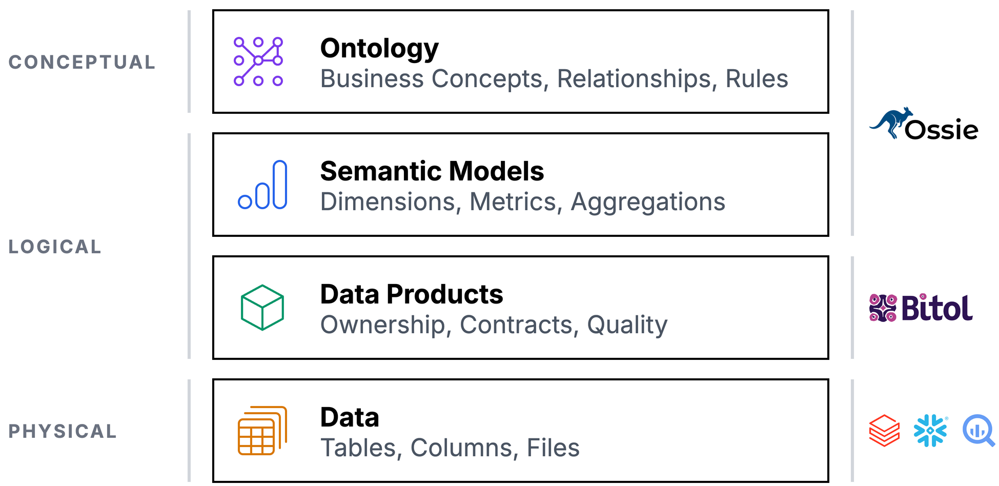
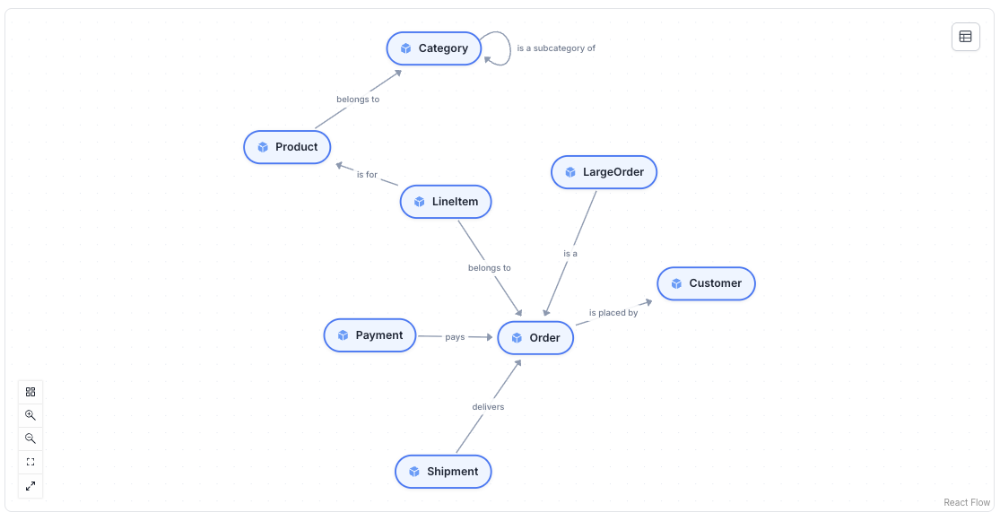
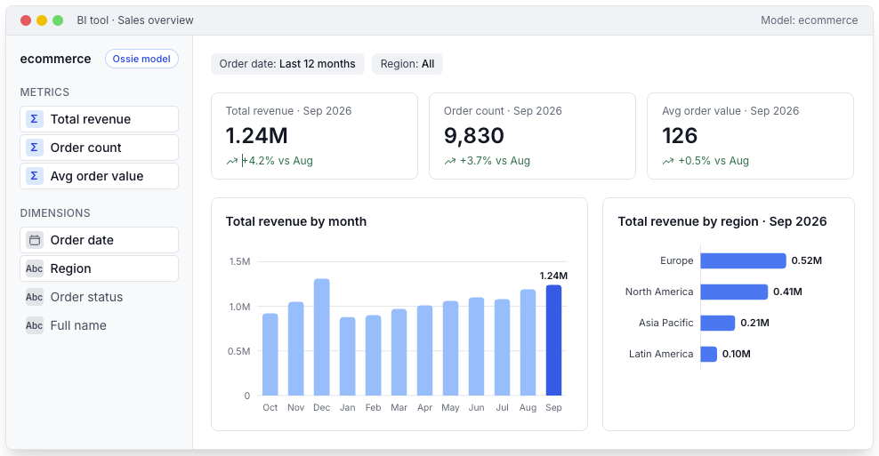

**语义数据的开放标准**



### 什么是语义数据？

语义数据为人和 Agent 提供可靠的业务上下文。表和列只描述数据是如何存储的，却不描述数据代表什么含义。语义数据补上了这层含义：业务概念及其相互关系、收入或流水这类指标的计算方式，以及某个数据产品归谁负责、由谁保证其质量。当这一层上下文以开放的、机器可读的格式被定义一次之后，分析师、BI 工具和 AI Agent 都会基于同一套定义来工作。Agent 不再靠猜列名来理解数据，每一个工具给出的数字也都相同。

### 为什么语义数据至关重要

语义技术已经存在多年，但随着 AI 的兴起，它终于变得愈发重要。大语言模型（LLM）需要上下文来理解用户想要什么，需要判断哪个数据产品承载了该业务领域的相关数据，还需要评估某个数据产品是否足够可靠、可以使用：
- **说业务语言。** 客户、订单、收入、流水等都以业务使用的术语来定义，而不是用表名和列名来定义。
- **为 Agent 提供业务上下文。** AI Agent 读取的正是你的分析师所依据的同一套定义，因此它们不必再猜 `cust_flg_2` 到底是什么意思。
- **每次都给同样的答案。** 每一个应用、每一个 Agent，对同一个问题今天和明天给出的都是同一个答案。
- **在正确的数据上工作。** 业务概念指向承载它们的数据产品，于是团队能选对数据源，并报告同样的数字。
- **节省 Token。** 一份紧凑的语义定义可以替代对表结构的探查、对数据的抽样以及反复失败的查询重试。Agent 需要的 Token 更少，回答也更快。

### 为什么需要开放标准

语义元数据正在成为一项核心业务资产。你对概念、指标和规则的定义，指导你的业务如何运作，而每一个与你数据打交道的工具都需要它们：业务应用、BI 工具、数据平台和 AI Agent。如今，这些工具中的大多数都用自己的格式保存自己的定义。开放标准则把这些零散的定义整合成一项归你所有的资产：
- **一种格式，多种工具。** Apache Ossie 描述本体（ontology）和语义模型，Bitol ODPS 和 ODCS 描述数据产品与数据契约。凡是支持这些标准的工具，读写的都是同一套定义。
- **没有供应商锁定。** 以开放格式保存的定义，在你新增或替换某个工具时依然归你所有，任何内容都不必从零重建。
- **语义即代码（Semantics as code）。** 把本体、语义模型和数据契约作为 YAML 文件存放在 Git 中。改动通过 Pull Request 和评审进入，CI 会依据 JSON Schema 对其校验，每一次发布都有版本记录。
- **发布到各处。** 每一次发布都会被推送进你的应用、数据平台和 AI 平台的知识库与上下文层，于是每个工具使用的都是最新的定义。参见下文的"分发语义数据"。

### Apache Ossie

Apache Ossie（孵化中）是一个由行业推动的语义数据开放标准。它的前身是 Open Semantic Interchange（OSI），由 Snowflake 及其合作伙伴于 2025 年 9 月发起，并于 2026 年 7 月以新名称进入 Apache 孵化器（Apache Incubator）。

有超过 50 家组织参与贡献，包括 Snowflake、Databricks、Salesforce、dbt Labs、Dremio、GoodData、RelationalAI 和 Honeydew。该规范在 Apache 软件基金会（ASF）的治理下公开开发，设有公开的邮件列表、GitHub 讨论，并且每一次规范改动都需要投票表决。它采用 Apache License 2.0 授权。

Ossie 覆盖语义数据的两个层次，两者都以 YAML 或 JSON 编写：
- **概念层 —— 本体（Ontology）：** 业务概念、它们之间的关系和规则，并映射到承载它们的数据集。规范 0.2.0（开发中）。
- **逻辑层 —— 语义模型（Semantic Models）：** 数据集、关系、指标，以及供 BI 工具、查询引擎和智能体使用的多方言表达式。规范 0.1.1（已发布），0.2.0 开发中。

源代码、议题和讨论都在 [GitHub](https://github.com/apache/ossie) 上。

### 本体（Ontology）

本体用业务自身的语言来描述业务：哪些概念重要、它们如何关联，以及始终成立的规则。它与数据存储在何处、如何存储无关。

下面是一个在线商店的本体，涵盖客户、订单、产品、支付和发货：



Ossie 为本体中的这些元素定义了 YAML 规范。

**本体（Ontology）：** 一个 Ossie 本体以版本号、名称开头，并可带有可选的描述和 AI 上下文：
```
version: "0.2.0.dev0"
name: ecommerce
description: Business concepts of an online store
ai_context:
  instructions: >
    Use this ontology to understand customers, orders,
    products, payments, and shipments.
    Amounts are always in cents.
  synonyms:
    - "customer: buyer, shopper, client"
    - "order: purchase, sale"
    - "product: item, article"
ontology:
  - concept: Customer
    type: EntityType
  - concept: Order
    type: EntityType
```
**概念（Concepts）：** 概念是业务中真正重要的事物。像 Customer（客户）和 Order（订单）这样的实体类型（EntityType）是被标识符引用的真实世界对象；像 CustomerNr（客户号）或 Amount（金额）这样的值类型（ValueType）是带有业务含义的数据类型，它们扩展了 String、Integer 或 Date 等内置类型。一个可选的 IRI 会赋予概念一个全局标识符，以便数据契约和其他工具能够引用它。
```
version: "0.2.0.dev0"
name: ecommerce
ontology:
  - concept: CustomerNr
    type: ValueType
    extends: [String]
    description: Customer number assigned at registration
  - concept: OrderNr
    type: ValueType
    extends: [String]
    description: Order number printed on the invoice
  - concept: Region
    type: ValueType
    extends: [String]
    description: Sales region
  - concept: Amount
    type: ValueType
    extends: [Integer]
    description: Monetary amount in cents
  - concept: Customer
    type: EntityType
    description: A person or company that buys from us
    identify_by: [ nr ]
  - concept: Order
    type: EntityType
    iri: http://example.com/ontology/webshop/Order
    description: A confirmed purchase by a customer
    identify_by: [ nr ]
```
**关系（Relationships）：** 关系（Relationships）把概念（Concepts）连接起来。每一条关系都归属于扮演其第一个角色的概念之下，因此 `Order.placed_by` 把一个订单和它的客户关联起来。多重性（multiplicities）说明一个订单最多由一个客户下单；口语化描述（verbalizations）用平实的业务语言描述每一条关联。
- **业务规则（Business Rules）：** 业务规则让本体精确。`requires` 声明始终成立的约束：金额永不为负，每个订单都有一个客户和一个日期。`derived_by` 从其他概念派生出某个概念，类似视图：LargeOrder（大额订单）就是任何总额达到或超过 1,000 的订单。
- **本体映射（Ontology Mappings）：** 本体映射把概念连接到数据。每个映射都内嵌一个语义模型，并从其字段填充概念和关系。`orders` 表中的每一行都成为一个 Order，关联到下单的 Customer 以及订单的金额合计。智能体现在能够把一个关于客户的问题，翻译成对正确表的查询。
- **完整示例（Full Example）：** 这是上面图示中完整的电商本体：值类型和实体类型、带口语化描述的关系、业务规则，以及到下方所示语义模型的映射。

参考：Apache Ossie Ontology Specification（本体规范）

```
version: "0.2.0.dev0"
name: ecommerce
description: Business concepts of an online store
ai_context:
  instructions: >
    Use this ontology to understand customers, orders,
    products, payments, and shipments.
    Amounts are always in cents.
  synonyms:
    - "customer: buyer, shopper, client"
    - "order: purchase, sale"
    - "product: item, article"
ontology:
  - concept: Customer
    type: EntityType
  - concept: Order
    type: EntityType
```

本体规范是即将发布的 Ossie 0.2.0 版本的一部分（当前为 0.2.0.dev0）。它包含用于校验的 JSON Schema 以及一份规范文档。在正式发布前预计仍会有改动。

### 语义模型（Semantic Models）

语义模型主要用在 BI 工具中，用于描述分析所需的数据：逻辑数据集及其字段、数据集之间的关系，以及在其之上计算的指标。每个数据集和每个字段都链接到底层的表和列，因此每个指标都能落到真实的数据上。表达式可以用多种 SQL 方言书写，于是 BI 工具、查询引擎和 AI 智能体都以同样的方式计算收入。

在 BI 工具里，语义模型表现为具名的指标和维度，业务用户可以把它们拖入报表：



每个 BI 工具（Power BI、Looker、Tableau 等）都用自己专有的格式来定义语义模型。Apache Ossie 定义了一个通用标准，让它们变得可以互换。让我们一步步来了解一个 Ossie 语义模型：

**语义模型（Semantic Model）：** 每个 Ossie 语义模型以版本号和模型定义开头：一个名称、一段描述，以及可选的 AI 上下文——后者帮助 AI Agent 正确理解并查询数据。
```
version: "0.1.1"
semantic_model:
  - name: ecommerce
    description: E-commerce analytics semantic model
    ai_context:
      instructions: >
        Use this model for e-commerce analytics.
        Revenue is always in cents.
        Active customers have placed an order in the last 90 days.
      synonyms:
        - "revenue: total_revenue, sales, income"
        - "customers: buyers, users, shoppers"
      examples:
        - "What was the total revenue last month?"
        - "How many active customers do we have?"
        - "Show me the top 10 products by revenue"
```
**数据集（Datasets）：** 数据集代表逻辑表（事实表或维度表）。每个数据集都有一个来源（source）、一个主键（primary key）和若干字段。字段必须提供多方言表达式，并可标记为维度。
```
version: "0.1.1"
semantic_model:
  - name: ecommerce
    description: E-commerce analytics semantic model
    datasets:
      - name: orders
        description: All customer orders
        source: analytics.orders
        primary_key:
          - order_id
        fields:
          - name: order_id
            description: Unique order identifier
            expression:
              dialects:
                - dialect: ANSI_SQL
                  expression: order_id
          - name: customer_id
            description: Customer identifier
            expression:
              dialects:
                - dialect: ANSI_SQL
                  expression: customer_id
            dimension: {}
          - name: order_total
            description: Total order amount in cents
            expression:
              dialects:
                - dialect: ANSI_SQL
                  expression: order_total
                - dialect: SNOWFLAKE
                  expression: ORDER_TOTAL
```
**关系（Relationships）：** 关系定义数据集之间的外键连接。它们指定"from"（多的一方）和"to"（一的一方）数据集以及连接列（join columns），使工具能够自动关联表。
```
version: "0.1.1"
semantic_model:
  - name: ecommerce
    datasets:
      - name: orders
        source: analytics.orders
        primary_key:
          - order_id
        fields:
          - name: customer_id
            expression:
              dialects:
                - dialect: ANSI_SQL
                  expression: customer_id
      - name: customers
        source: analytics.customers
        primary_key:
          - customer_id
        fields:
          - name: customer_id
            expression:
              dialects:
                - dialect: ANSI_SQL
                  expression: customer_id
    relationships:
      - name: orders_to_customers
        from: orders
        to: customers
        from_columns:
          - customer_id
        to_columns:
          - customer_id
```
**指标（Metrics）：** 指标是集中定义的聚合业务度量。每个指标都有多方言表达式，从而确保所有工具之间的指标定义保持一致，不再出现互相冲突的"收入"数字。
```
version: "0.1.1"
semantic_model:
  - name: ecommerce
    datasets:
      - name: orders
        source: analytics.orders
        fields:
          - name: order_total
            expression:
              dialects:
                - dialect: ANSI_SQL
                  expression: order_total
    metrics:
      - name: total_revenue
        description: Total order revenue in cents
        expression:
          dialects:
            - dialect: ANSI_SQL
              expression: SUM(order_total)
            - dialect: SNOWFLAKE
              expression: SUM(ORDER_TOTAL)
      - name: order_count
        description: Total number of orders
        expression:
          dialects:
            - dialect: ANSI_SQL
              expression: COUNT(*)
```
**自定义扩展（Custom Extensions）：** 自定义扩展允许在不污染核心模型的前提下加入厂商专有的元数据。每个扩展针对特定厂商（Snowflake、Databricks、dbt 等），并把配置以 JSON 字符串的形式存放。
```
version: "0.1.1"
semantic_model:
  - name: ecommerce
    datasets:
      - name: orders
        source: analytics.orders
    metrics:
      - name: total_revenue
        expression:
          dialects:
            - dialect: ANSI_SQL
              expression: SUM(order_total)
    custom_extensions:
      - vendor_name: SNOWFLAKE
        data: "{\"warehouse\": \"ANALYTICS_WH\", \"role\": \"ANALYST\"}"
      - vendor_name: DATABRICKS
        data: "{\"catalog\": \"main\", \"schema\": \"analytics\"}"
```


**完整示例（Full Example）：** 这是一个把所有元素整合在一起的完整 Ossie 语义模型：带 AI 上下文的模型定义、带字段和多方言表达式的数据集、关系、指标，以及厂商专有扩展。
```
version: "0.1.1"
semantic_model:
  - name: ecommerce
    description: E-commerce analytics semantic model
    ai_context:
      instructions: >
        Use this model for e-commerce analytics.
        Revenue is always in cents.
        Active customers have placed an order in the last 90 days.
      synonyms:
        - "revenue: total_revenue, sales, income"
        - "customers: buyers, users, shoppers"
      examples:
        - "What was the total revenue last month?"
        - "How many active customers do we have?"
        - "Show me the top 10 products by revenue"
    datasets:
      - name: orders
        description: All customer orders
        source: analytics.orders
        primary_key:
          - order_id
        fields:
          - name: order_id
            description: Unique order identifier
            expression:
              dialects:
                - dialect: ANSI_SQL
                  expression: order_id
          - name: customer_id
            description: Customer identifier
            expression:
              dialects:
                - dialect: ANSI_SQL
                  expression: customer_id
            dimension: {}
          - name: order_date
            description: Date the order was placed
            expression:
              dialects:
                - dialect: ANSI_SQL
                  expression: order_date
            dimension:
              is_time: true
          - name: order_total
            description: Total order amount in cents
            expression:
              dialects:
                - dialect: ANSI_SQL
                  expression: order_total
                - dialect: SNOWFLAKE
                  expression: ORDER_TOTAL
          - name: order_status
            description: Current status of the order
            expression:
              dialects:
                - dialect: ANSI_SQL
                  expression: order_status
            dimension: {}
      - name: customers
        description: Customer master data
        source: analytics.customers
        primary_key:
          - customer_id
        fields:
          - name: customer_id
            description: Unique customer identifier
            expression:
              dialects:
                - dialect: ANSI_SQL
                  expression: customer_id
          - name: full_name
            description: Full name of the customer
            expression:
              dialects:
                - dialect: ANSI_SQL
                  expression: first_name || ' ' || last_name
                - dialect: SNOWFLAKE
                  expression: CONCAT(first_name, ' ', last_name)
            dimension: {}
          - name: region
            description: Geographic region
            expression:
              dialects:
                - dialect: ANSI_SQL
                  expression: region
            dimension: {}
    relationships:
      - name: orders_to_customers
        from: orders
        to: customers
        from_columns:
          - customer_id
        to_columns:
          - customer_id
    metrics:
      - name: total_revenue
        description: Total order revenue in cents
        expression:
          dialects:
            - dialect: ANSI_SQL
              expression: SUM(order_total)
            - dialect: SNOWFLAKE
              expression: SUM(ORDER_TOTAL)
      - name: order_count
        description: Total number of orders
        expression:
          dialects:
            - dialect: ANSI_SQL
              expression: COUNT(*)
      - name: avg_order_value
        description: Average order value
        expression:
          dialects:
            - dialect: ANSI_SQL
              expression: SUM(order_total) / NULLIF(COUNT(*), 0)
    custom_extensions:
      - vendor_name: SNOWFLAKE
        data: "{\"warehouse\": \"ANALYTICS_WH\", \"role\": \"ANALYST\"}"
      - vendor_name: DATABRICKS
        data: "{\"catalog\": \"main\", \"schema\": \"analytics\"}"
```

> 参考：Apache Ossie Core Specification（核心规范）

这些示例使用已发布的 0.1.1 核心规范。0.2.0 版本正在开发中：每个文档在根节点只承载单个模型（移除了 `semantic_model` 列表），字段和指标会获得逻辑数据类型，并新增 BigQuery、DAX 以及 Ossie 自带的可移植 SQL 等方言。参见规范文档和 JSON Schema。

**注意：** Ossie 尚未达到 1.0 版本。我们鼓励尽早采用并给出反馈，但请为未来版本中的破坏性变更做好准备。

### 数据产品与数据契约（Data Products and Data Contracts）

本体和语义模型描述的是数据的含义。数据产品和数据契约描述的则是实际交付的数据：它归谁所有、在哪里可用、其结构（schema）如何，以及消费者可以信赖的质量和服务水平。

Bitol——Linux 基金会旗下 LF AI & Data 基金会的一个项目——为这一层维护两项开放标准。两者均采用 Apache License 2.0 授权：

- **逻辑层 —— Open Data Product Standard（ODPS）：** 一个数据产品的标识、负责人和状态，以及引用数据契约的输入端口和输出端口。版本 1.1.0。
- **逻辑层 —— Open Data Contract Standard（ODCS）：** 生产者与消费者之间的约定：结构、质量规则、SLA、服务器和团队。版本 3.2.0。

数据产品的每个输出端口都对应一份数据契约。契约从消费者的视角定义数据产品：他们能得到什么数据、在哪里访问它，以及可以信赖哪些质量和服务水平。

**语义模型本身也可以是一个数据产品。** 当一个语义模型有清晰的归属权时，它可以成为一个独立的数据产品。和任何其他数据产品一样，它可以通过一份数据契约来规范和保障质量：契约描述消费者可使用的指标和维度（ODCS 3.2 为度量和维度新增了 `semanticType`），其质量规则和 SLA 确保数字准确且新鲜。

让我们一步步来了解一份数据契约：

- **数据契约（Data Contract）：** 一份数据契约从消费者的视角定义数据产品。它始于一些基本要素，如 `id`、`version`、`status` 以及所属的数据产品；描述目的（purpose）、用途（usage）和限制（limitations）；并列出消费者访问数据所在的服务器——这里是一个 Snowflake schema。
- **结构（Schema）：** 结构定义表及其属性，包括业务名称、逻辑类型和物理类型、键和分类（classifications）。类型语义的权威定义（authoritative definitions）把 `orders` 表及其标识符列链接到本体中的概念。
- **质量与 SLA（Quality and SLAs）：** 质量规则把期望转化为可执行的检查，形式可以是 SQL 查询，也可以是预定义的度量（例如行数）。本体说"金额永不为负"，契约就在数据中核验这一点。SLA 属性说明新鲜度（freshness）、可用性（availability）和保留期（retention）。
- **数据产品（Data Product）：** 数据产品是一个团队所拥有并对外提供的东西。它的 ODPS 文件说明标识、状态、领域（domain）和负责团队，并列出输出端口。每个输出端口通过 `contractId` 引用它的数据契约，因此 orders 端口就由上面这份契约来描述。
- **完整示例（Full Example）：** 这是 orders 数据产品的完整数据契约：基本要素、服务器、带语义链接的结构、质量规则、SLA、团队和 AI 上下文。

参考：Open Data Contract Standard（开放数据契约标准）

```yaml
apiVersion: v3.2.0
kind: DataContract
id: orders
name: Orders
version: 1.0.0
status: active
domain: sales
dataProduct: orders
description:
  purpose: Web shop orders for analytics and AI agents
  usage: Revenue analysis and order volume trends
  limitations: Only orders placed since 2020-01-01
servers:
  - server: production
    environment: prod
    type: snowflake
    account: acme-eu
    database: SALES
    schema: ANALYTICS
```

这些示例可作为 orders.odcs.yaml 和 orders.odps.yaml 获取。使用开源的 Data Contract CLI 校验一份数据契约并据此测试你的数据，在 Data Contract Editor 中编辑它，并用 Data Product CLI 管理数据产品。可在 datacontract.com 了解更多关于数据契约的信息。

**数据契约编辑器（Data Contract Editor）**

使用开源的 Data Contract Editor（GitHub 仓库）以可视化方式创建和编辑数据契约。它为 ODCS 数据契约提供表单、图和 YAML 三种视图，并在你编辑的同时校验契约。打开时默认载入上面那份 orders 数据契约。

> *（试试看，它是可交互的！editor.datacontract.com）*

### 分发语义数据（Distributing Semantic Data）

语义数据并不存在于单一平台之中。业务定义需要被整合进每一个相关的应用、数据平台和 AI 平台。这正是保持一致性的关键：所有平台共享同样的语义，基于同样相互链接的数据产品工作，并返回同样的数字。

本体由领域专家来维护——也就是那些真正了解在你的业务中"客户""订单""退货"意味着什么的人。

> *（示意：领域专家 ⇄ 维护/提案/反馈 ⇄ 语义：本体、语义模型、数据契约）*
>
> 应用（CRM、ERP、网店）：上月收入 1.24M
> 数据平台（Snowflake、Databricks）：上月收入 1.24M
> AI 平台（智能体、助手、MCP）：上月收入 1.24M
>
> 销售与服务、分析师与控制器、管理者以及其他所有人——业务价值产生在业务用户工作的地方：知识库、文档、代码、数据产品、邮件。
>
> 语义智能体在一个循环中运行。

- **由领域专家维护语义。** 领域专家维护语义：本体、语义模型和数据契约，以 Apache Ossie 和 ODCS 等开放格式书写。
- **整合进每个平台。** 同一套定义被推送进所有相关应用、数据平台和 AI 平台的知识库与上下文层。业务价值正是在这里产生的：在业务用户每天使用的工具里。
- **到处是同样的数字。** 每个平台都使用同样的语义。向其中任何一个询问上月的收入，答案都是 1.24M。

**语义智能体会阅读你的知识库。** LLM 能够从已有的业务知识中提取语义。

**提案，并在循环中评审。** 智能体把它的发现转化为交给领域专家的提案。被批准的改动会到达每一个平台，而反馈又会改进下一轮的运行。这就形成了一个正向的反馈循环：每一次被批准的改动都让所有平台上的答案更准确，每一次批准或拒绝都教会智能体专家们接受什么。随着时间推移，提案越变越好，评审越变越快，语义也能跟上业务的发展。

**避免语义层面的供应商锁定。** 许多平台都提供自己的语义层。在那里编写的定义以专有格式存放：它们必须为每一个其他平台重建一次，当你更换工具时还得再重建一次。把可信数据源（source of truth）保持在 Apache Ossie 和 ODCS 等开放格式中，由你的组织拥有并纳入版本管理，然后让每个平台去消费它。

### 常见问题（Frequently Asked Questions）

**什么是语义数据？**
语义数据为人类和智能体提供可靠的业务上下文。表和列描述数据是如何存储的，却不描述数据代表什么含义。语义数据补上了这层含义：业务概念及其相互关系、收入或流失这类指标的计算方式，以及某个数据产品归谁负责、由谁保证其质量。

**什么是 Apache Ossie？**
Apache Ossie（孵化中）是一个由行业推动、与厂商无关（vendor-neutral）的语义数据开放标准。它为实体本体和语义模型定义了 YAML 和 JSON 格式，从而让业务定义在 AI 智能体、BI 平台和分析工具之间交换时始终保持一致。它在 Apache 软件基金会的治理下开发，并采用 Apache License 2.0 授权。

**Apache Ossie 和 Open Semantic Interchange（OSI）是同一个东西吗？**
是的。Open Semantic Interchange（OSI）由 Snowflake 及其合作伙伴于 2025 年 9 月发起。2026 年 7 月，该项目进入 Apache 孵化器，并更名为 Apache Ossie，以避免与其他使用 OSI 这一缩写的项目产生混淆。

**本体和语义模型有什么区别？**
本体是概念层的：它描述业务概念、它们之间的关系和规则，与数据存储在何处、如何存储无关。语义模型是逻辑层的：它描述数据集、字段、关系和指标，并链接到真实的表和列，使 BI 工具、查询引擎和 AI 智能体都以同样的方式计算指标。本体映射把两者连接起来。

**Apache Ossie 本体是什么？**
Ossie 本体是对业务的概念模型。它定义概念（实体类型和值类型）、概念之间的关系（带多重性和口语化描述），以及业务规则（`requires` 和 `derived_by` 表达式）。本体映射把概念和关系连接到 Ossie 语义模型的数据集和字段。

**Apache Ossie 语义模型包含什么？**
Ossie 语义模型包含数据集（带字段的逻辑事实表和维度表）、关系（数据集之间的外键连接）、指标（聚合业务度量，如收入和订单数）、AI 上下文（面向 AI 智能体的指令、同义词和示例），以及用于存放厂商专有元数据的自定义扩展。

**Apache Ossie、ODPS 和 ODCS 如何相互配合？**
Apache Ossie 的本体和语义模型描述数据的含义。Bitol 标准描述被交付的数据：Open Data Product Standard（ODPS）定义一个数据产品及其负责人和输出端口，Open Data Contract Standard（ODCS）定义每个输出端口的结构、质量规则、SLA 和 AI 上下文。ODCS 的权威定义可以把表和列链接到本体概念。

**Apache Ossie 支持哪些平台？**
Ossie 支持 ANSI SQL、Snowflake、Databricks、Tableau 和 MDX 的多方言表达式；在 0.2.0 版本中还新增了 BigQuery、DAX、MAQL、Sigma、ThoughtSpot，以及一种可移植的 Ossie SQL 方言。针对 Snowflake、Salesforce、dbt、Databricks、GoodData 等的厂商专有元数据存放在自定义扩展中。

**Apache Ossie 与厂商专有的语义层有何不同？**
与厂商专有的语义层不同，Ossie 是一项与厂商无关的规范，可以在任意平台之间相互转换。这避免了元数据锁定，并让同一套定义能够同时供给 AI、数据、BI 和软件平台。

### 关于（About）

本网站由 Entropy Data 维护。我们热衷于数据的开放标准，并坚信通用的语义标准对于分析与 AI 的未来至关重要。

我们在数据契约和数据网格（data mesh）方面的工作让我们认识到：互操作性需要开放、与厂商无关的标准。Apache Ossie 是下一步：确保业务语义随数据一同流转，而无论由哪个工具来处理它。

Apache Ossie 规范采用 Apache License 2.0 授权。Apache Ossie 是正在 The Apache Software Foundation（ASF）下孵化的一个项目。本网站是独立的，并非 ASF 官方页面。官方项目网站为 ossie.apache.org。

本网站由 Entropy Data 维护 · 法律说明

---

*本文档为 https://opensemantic.com/ 页面正文的完整中文翻译。文中 YAML 代码示例与部分厂商/产品名称（Apache Ossie、ODPS、ODCS、Bitol、Snowflake、Databricks 等）按惯例保留原文。原文发布日期 2026-03-18，最近修改日期 2026-10-06。*
