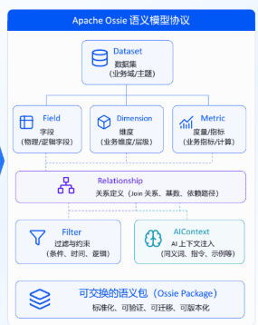

# Apache Ossie 语义层如何在 DataAgent 中落地

> 系列前作：[《从 SQL 到 OSI：当"数据是什么意思"也有了标准答案》](从%20SQL%20到%20OSI：当“数据是什么意思”也有了标准答案.md)、[《Apache Ossie 开放语义标准》](Apache%20Ossie%20开放语义标准.md)、[《Ossie，会不会成为"开源 Palantir"的起点？》](Ossie%20，会不会成为“开源%20Palantir”的起点？.md)。前两篇讲"为什么需要语义层"和"标准长什么样"，这一篇讲**工程落地**：我们如何把 Apache Ossie 语义模型真正变成 DataAgent 的语义层——从任务 SQL/DDL 原始语料，到可校验、可版本化的 Ossie 语义包，再到 Agent 运行时的每一次取数。

## 1. 需求分析：DataAgent 缺的不是 SQL 能力，而是语义

### 1.1 三个真实失败案例

DataAgent（自然语言数据分析 Agent）的典型工作流是：自然语言问题 → Schema 链接 → 生成 SQL → 执行 → 结果解读。上线初期我们统计了失败样本，问题高度集中在三个环节：

1. **猜列名。** 用户问"上个月活跃客户数"，Agent 在几十张表里挑中了 `cust_flg_2`——一个没人记得含义的状态位。Schema 链接靠列名相似度硬猜，准确率随表数量增加快速衰减。
2. **口径漂移。** "GMV" 在交易任务里是支付口径、在财务任务里剔除退款、在营销任务里只算已发货。三个任务 SQL 里写着三套逻辑，Agent 随机命中其中一套，给出的数字"今天和明天不一样"。
3. **Token 黑洞。** 没有语义先验时，Agent 要先 `DESC` 表、抽样数据、试错查询，一个简单问题消耗上万 Token、重试三四轮才可能答对。

这三个问题的共同根因是：**表和列只描述数据如何存储，不描述数据代表什么**。Agent 需要的不是更强的 SQL 生成能力，而是一层"业务含义"的先验知识——这正是语义层。

### 1.2 为什么是 Ossie，以及它和 OKF 的关系

我们最早用 OKF（Open Knowledge Format）知识库承载 DataAgent 的语义：把任务 SQL、DDL 编译成 Markdown + YAML 前置元数据的知识包。OKF 解决了"知识容器"问题——来源追溯、可信度信号、已证明计算（Attested Computation）这些设计至今仍在用。但实践中发现两类缺口：

- **结构约束不足。** OKF 正文是自由 Markdown，"指标口径"写在散文里，无法被机器校验，也无法直接编译成 SQL 表达式；
- **多方言表达缺失。** 同一指标在 Hive 和 ODPS（MaxCompute）上的表达式不同，OKF 没有表达这件事的标准位置。

Apache Ossie（前身 OSI，2026 年 7 月进入 Apache 孵化器）恰好补上这两块：它是语义模型的**领域协议**——数据集、字段、维度、指标、关系都有 JSON Schema 约束的结构化节点，表达式天然支持多方言。于是我们的分工变成：

| 载体 | 承载内容 | 形态 |
|------|---------|------|
| **Ossie 语义包** | 结构化语义：数据集/字段/维度/指标/关系/过滤/AI 上下文 | YAML，Schema 校验，可编译为 SQL |
| **OKF 知识库** | 宽知识：任务说明、口径叙事、血缘故事、排查经验 | Markdown + YAML 前置元数据 |

两者互链：Ossie 指标节点的 `description` 给出权威口径，OKF 概念文档讲述这个口径的来龙去脉。本文聚焦 Ossie 这一层。

## 2. 协议解析：Ossie 语义模型的七要素

落地前先吃透协议。下图是我们实施时遵循的 Ossie 语义模型协议要素视图：



对照 Apache Ossie 核心规范（core-spec，当前开发版 0.3.0.dev0），逐要素拆解：

### 2.1 Dataset：数据集（数据库表，业务域/主题）

逻辑数据集代表事实表或维度表，通过 `source` 锚定物理表，并声明 `primary_key` / `unique_keys`。它是语义层的"地址簿"：业务概念指向承载它的数据产品，Agent 因此能"在正确的数据上工作"。

### 2.2 Field：字段（物理/逻辑字段）

字段是行级属性，可以是物理列引用，也可以是计算表达式。两个关键设计：

- **多方言表达式**：`expression.dialects` 列表允许同一字段在 ANSI_SQL、HIVE、MAXCOMPUTE、SNOWFLAKE 等方言下各写一份表达式（`dialect` 是自由字符串，社区注册表维护在仓库 `extensions/dialects.md`）；
- **逻辑数据类型**：`datatype` 声明字段的逻辑值类型（Date、Integer、String 等），与物理类型解耦。

### 2.3 Dimension：维度（业务维度/层级）

维度不是独立节点，而是字段的**角色标记**：`dimension: {}` 把字段标为可分组/可过滤维度，`dimension.is_time: true` 标记时间维度。规范特别强调 `datatype` 与 `is_time` 是两件独立的事——前者回答"存的是什么类型的值"，后者回答"是否应作为时间轴"。默认规则很实用：`datatype` 为 Date/Time/DateTime/DateTimeTz 时 `is_time` 默认为 true，审计类时间列（如 `created_at`）可显式 `is_time: false` 退出时间轴。

### 2.4 Metric：指标（业务指标，非业务指标/计算）

指标是语义层一致性的核心。0.3.0.dev0 引入了**两级指标作用域**：

- **数据集级指标（dataset-scoped）**：挂在 dataset 下，表达式只能引用本数据集声明的字段（单段名）与本源物理列（`source.column` 形式），计算完全闭合在数据集内；
- **模型级指标（model-scoped）**：挂在模型根下，用多段名 `dataset.field` 跨数据集组合，且可以通过 `AGG(dataset.metric)` 复用数据集级指标——例如 `AGG(orders.gmv) / COUNT(DISTINCT customers.customer_id)`。

注意规范的一条硬约束：`AGG(...)` 调用上**不允许**再挂 `FILTER (WHERE ...)` 子句，过滤条件必须下沉到数据集级指标内部。这条约束直接决定了我们编译层的 Filter 落位规则（见 4.2）。

### 2.5 Relationship：关系（Join 关系、基数、依赖路径）

关系定义数据集之间的外键连接：`from`（多的一方）/ `to`（一的一方）+ 连接列。对 DataAgent 而言，关系表就是**Join 路径图**：多表问题不再靠 Agent 现场猜 Join 条件，而是沿声明好的路径展开，基数信息还决定了聚合是否会 fan-out 翻倍。

### 2.6 Filter：过滤约束（条件、时间、逻辑）

需要诚实说明的一点：**当前规范并没有独立的顶层 Filter 节点**。过滤约束在规范中的承载位置是三处：字段/维度（含 `is_time` 时间角色）、指标表达式中的 `FILTER (WHERE ...)` 子句、以及扩展节点。但"过滤约束"在业务上是一等公民——"GMV 只算支付订单""时间分析必须带分区条件"这类规则必须有地方放。因此我们的实施策略是：**编译层把 Filter 作为一等中间要素抽取和治理，输出时按规范落位到上述三个载体**（规则见 4.2）。协议视图里保留 Filter，正是为了在编译层给它一个显式位置。

### 2.7 AIContext：AI 上下文（同义词、指令、示例等）

`ai_context` 可出现在模型、数据集、字段各级，携带 `instructions`（使用规则）、`synonyms`（同义词映射）、`examples`（示例问题）。它是语义层面向 Agent 的**自然语言接口**：用户说"销售额"，Agent 通过 synonyms 命中 `gmv`；说"按地区拆"，命中 `region` 维度。语义层省下的 Token，大部分省在这里——不再需要探查和试错。

### 2.8 Ossie Package：可交换的语义包

协议视图最底层的"可交换语义包"，对应四项工程属性：

- **标准化**：YAML/JSON 双格式，`ossie-schema.json` 机器可读 Schema；
- **可验证**：仓库自带 validation 工具链与 compliance 便携性评分器，CI 可校验；
- **可迁移**：apache/ossie-converters 提供与 dbt、GoodData、Polaris、Salesforce 等格式的双向转换，语义资产不被锁定；
- **可版本化**：语义即代码——语义包进 Git，改动走 PR 评审，发布打 tag。

> **版本演进提示**：规范迭代很快。0.1.1（已发布）→ 0.2.0/0.3.0.dev0（开发中）的破坏性变更包括：每个文档只承载**单个模型**（移除 `semantic_model` 列表）、字段/指标获得逻辑 `datatype`、指标分两级作用域、`custom_extensions` 更名 `nonportable_extensions`。落地实现必须 pin 住 schema 版本并保留迁移脚本（见坑六）。

## 3. 架构设计：语义层在 DataAgent 中的位置

### 3.1 五层架构

```
┌─────────────────────────────────────────────────────────────┐
│ ⑤ Agent 运行时层  ReActAgent：意图理解 → 语义锚定 → SQL 生成 → 解读 │
├─────────────────────────────────────────────────────────────┤
│ ④ 语义服务层  MCP 工具：search_datasets / get_metric /          │
│               join_path / render_sql（按方言渲染表达式）          │
├─────────────────────────────────────────────────────────────┤
│ ③ 语义资产层  Ossie Package Git 仓库：一文档一模型、Schema CI      │
│               校验、版本 tag、CHANGELOG                          │
├─────────────────────────────────────────────────────────────┤
│ ② 编译层  方言解析(sqlglot) → 统一中间模型 → Ossie 骨架渲染        │
│           → LLM 丰富（只写描述性字段）                            │
├─────────────────────────────────────────────────────────────┤
│ ① 原始语料层  任务 SQL、DDL（Hive/ODPS）、OKF raw/ 知识语料        │
└─────────────────────────────────────────────────────────────┘
```

### 3.2 语料到协议要素的映射表

编译层的核心是一张映射表——每类语料证据只允许产出特定的协议要素：

| 原始语料证据 | 产出的 Ossie 要素 | 说明 |
|-------------|------------------|------|
| DDL 建表语句 | Dataset + `source`/`primary_key` | 表名、注释、存储属性 |
| DDL 列定义 + COMMENT | Field + `description`/`datatype` | 物理列 → 逻辑字段 |
| 分区列、日期列 | Dimension（`is_time: true`） | Hive 分区列是时间维度的强证据 |
| 任务 SQL 的 GROUP BY 列 | Dimension（普通维度） | 被反复分组即维度 |
| 任务 SQL 的聚合 SELECT | Metric（数据集级） | 聚合表达式 + WHERE 过滤一起抽取 |
| 任务 SQL 的 JOIN 条件 | Relationship | 多任务重复出现的 Join 才固化 |
| 任务 SQL 的 WHERE 条件 | Filter（中间要素） | 再按规则落位（见 4.2） |
| LLM 丰富产物 | AIContext + 描述润色 | 只写描述性字段，不碰表达式 |

### 3.3 三条设计决策

1. **编译而非手写。** 语义包从语料编译而来，保证语义与真实任务 SQL 同源；手写语义层最大的命运是写完即过期。
2. **确定性优先，LLM 兜底。** 方言解析、映射、渲染全部是确定性代码；LLM 只做最后一步"丰富"，且权限被限制在描述性字段内——**口径由语料决定，不由模型发明**。
3. **语义包是唯一事实源。** Agent 运行时禁止自造指标表达式，所有聚合必须经 `render_sql` 从语义包渲染；这与 OKF 的"已证明计算"一脉相承：数字必须能追溯到被认可的计算方式。

## 4. 核心实现：从 SQL/DDL 到 Ossie 包的四段编译流水线

### 4.1 第一段：确定性抽取

方言可插拔是第一步。Hive 用 sqlglot 内置 `hive` 方言；ODPS 用社区插件 `sqlglot-maxcompute`（要求 sqlglot ≥ 30.1，支持 LIFECYCLE、RANGE CLUSTERED BY、AUTO PARTITIONED BY、TBLPROPERTIES、COMMENT 等扩展语法）。抽取产物是统一中间模型：

```python
import sqlglot

# 方言可插拔：Hive 用 sqlglot 内置 hive 方言；
# ODPS（MaxCompute）由社区插件 sqlglot-maxcompute 提供（要求 sqlglot >= 30.1），
# 安装后即可以 read="maxcompute" 解析 LIFECYCLE / RANGE CLUSTERED BY 等扩展语法

def parse_statements(statements: list[str], dialect: str):
    """多语句 .sql 文件先切分再逐条解析；单条失败降级记录、不中断整批。"""
    results = []
    for stmt in statements:
        try:
            results.append(sqlglot.parse_one(stmt, read=dialect))
        except sqlglot.errors.ParseError as e:
            log_degraded(stmt, e)   # 降级：记录原文 + 错误，交给 LLM 兜底通道
    return results
```

中间模型 `TableMetadata` / `TaskMetadata` 只保留公共字段与方言扩展字段两类：

| 类别 | 字段 |
|------|------|
| 公共 | 表名（ODPS 为 `project.table`）、列（名/类型/注释）、分区、主键候选、血缘（读表/写表） |
| Hive 扩展 | STORED AS / SERDE / LOCATION / EXTERNAL |
| ODPS 扩展 | LIFECYCLE、聚簇方式、项目名 |

两个工程细节：**多语句文件先切分再解析**，一条坏 SQL 不能拖垮整批语料；**ODPS 脚本模式的 `@var :=` 变量先预处理**为匿名中间表记录，否则血缘链在变量处断裂。

### 4.2 第二段：Ossie 骨架渲染

中间模型按 3.2 的映射表渲染为规范 YAML。下面是一份编译产物示例（销售域，pin 在 0.3.0.dev0 文档形态：一文档一模型）：

```yaml
name: sales_analytics
description: 销售域语义模型：订单、客户与统一 GMV 口径
ai_context:
  instructions: >
    用于销售分析。GMV 一律使用 orders.gmv 指标（支付口径、剔除退款）；
    金额单位统一为分；时间分析一律使用 order_date 时间维度并带分区条件。
  synonyms:
    - "gmv: 成交额, 销售额, revenue, sales"
    - "region: 销售地区, 大区, area"
  examples:
    - "上个月的 GMV 是多少？"
    - "按地区拆解本季度 GMV"
datasets:
  - name: orders
    description: 订单事实表（每行一笔订单）
    source: dw.dwd_trade_order_df
    primary_key: [order_id]
    fields:
      - name: order_id
        description: 订单号
        datatype: String
        expression:
          dialects:
            - dialect: ANSI_SQL
              expression: order_id
      - name: order_date
        description: 订单日期（Hive 分区列 dt）
        datatype: Date
        dimension:
          is_time: true
        expression:
          dialects:
            - dialect: ANSI_SQL
              expression: dt
            - dialect: HIVE
              expression: dt
      - name: region
        description: 销售地区
        datatype: String
        dimension: {}
        expression:
          dialects:
            - dialect: ANSI_SQL
              expression: region
      - name: pay_amount
        description: 支付金额（单位：分）
        datatype: Integer
        expression:
          dialects:
            - dialect: ANSI_SQL
              expression: pay_amount
            - dialect: MAXCOMPUTE
              expression: pay_amount
    metrics:                      # 数据集级指标：计算闭合在本数据集内
      - name: gmv
        description: 成交总额 = 支付订单的支付金额合计，剔除退款
        expression:
          dialects:
            - dialect: ANSI_SQL
              expression: SUM(pay_amount) FILTER (WHERE order_status = 'PAID' AND refund_flag = 0)
            - dialect: MAXCOMPUTE
              expression: SUM(IF(order_status = 'PAID' AND refund_flag = 0, pay_amount, 0))
  - name: customers
    description: 客户主数据
    source: dw.dim_customer_df
    primary_key: [customer_id]
    fields:
      - name: customer_id
        description: 客户号
        datatype: String
        expression:
          dialects:
            - dialect: ANSI_SQL
              expression: customer_id
relationships:
  - name: orders_to_customers
    from: orders
    to: customers
    from_columns: [customer_id]
    to_columns: [customer_id]
metrics:                          # 模型级指标：跨数据集组合
  - name: gmv_per_customer
    description: 客均 GMV
    expression:
      dialects:
        - dialect: ANSI_SQL
          expression: AGG(orders.gmv) / COUNT(DISTINCT customers.customer_id)
```

**Filter 的落位规则**（编译层一等要素 → 规范载体）：

| Filter 类型 | 语料形态 | 落位载体 |
|------------|---------|---------|
| 时间/分区约束 | `WHERE dt = '${bizdate}'` | 字段 `dimension.is_time: true` + 模型 `ai_context.instructions` 强制带分区条件 |
| 指标内业务条件 | 聚合 SELECT 同句的 `WHERE order_status = 'PAID'` | 数据集级指标表达式内的 `FILTER (WHERE ...)`（ODPS 无 FILTER 语法则渲染为 `SUM(IF(...))`） |
| 全局业务逻辑 | 跨任务重复出现的常量条件 | 数据集/字段 `description` + `ai_context.instructions` 叙述 |

注意模型级指标的 `AGG(...)` 上不挂 FILTER——过滤全部下沉到 `orders.gmv` 内部，这正是 2.4 提到的规范硬约束在编译层的体现。

### 4.3 第三段：LLM 丰富

骨架只有"机器语义"，缺"业务语义"。第三段把骨架 + 语料摘录（任务名、COMMENT、OKF 相关概念文档）渲染成 Prompt，让 LLM 补全：

- 字段/指标/数据集的 `description` 业务化润色；
- 模型级 `ai_context`：instructions（使用规则）、synonyms（同义词）、examples（示例问题）。

**Guardrail 是这一段的灵魂**：LLM 输出只允许覆盖描述性字段（description / ai_context），任何对 `expression`、`source`、`primary_key`、`relationships` 的改动在合并阶段直接丢弃；每段丰富结果的语料出处与丰富模型版本，记录在与语义包互链的 OKF 概念文档中（ vendor 专有记录亦可放 `nonportable_extensions`，但不进入可移植语义）。Prompt 里显式声明：

```text
你是语义层编辑。输入是编译自任务 SQL/DDL 的 Ossie 语义骨架。
你只能修改 description 与 ai_context 字段；
禁止修改 expression、source、primary_key、relationships、metrics 结构；
所有业务断言必须能在所附语料摘录中找到证据，无证据则留空。
```

### 4.4 第四段：校验与发布

语义包以 Git 仓库形态管理：

```
semantic-packages/
├── sales/
│   ├── sales_analytics.yaml        # 一文档一模型
│   └── CHANGELOG.md
├── supply/
│   └── inventory_analytics.yaml
├── schema/
│   └── ossie-schema.json           # pin 住的规范 Schema 版本
└── ci/
    └── validate.py                 # Schema 校验 + 编译层附加规则
```

CI 做三层校验：① 用 pin 住的 `ossie-schema.json` 做 Schema 校验；② 编译层附加规则——字段名与数据集级指标名同命名空间不得冲突（规范硬约束）、`AGG()` 上不得挂 FILTER、`source` 必须能在数据目录中解析；③ 丰富段 diff 审查——LLM 是否越权改了表达式。发布打语义化版本 tag，CHANGELOG 记录口径变更——**指标口径的修改等同于财务制度修订，必须走 PR 评审**。

## 5. 运行时消费：DataAgent 如何用语义包回答一个问题

以"上个月的 GMV 按地区拆一下"为例，运行时链路如下：

1. **语义锚定。** Agent 调 MCP 工具 `search_datasets("GMV 地区")`，语义服务用 `ai_context.synonyms` 把"GMV"命中 `orders.gmv`、"地区"命中 `orders.region`，返回命中的指标/维度节点及其 description；
2. **路径与约束解析。** `join_path(orders, [])` 确认单表即可；`get_metric("orders.gmv")` 返回指标节点，其中已内含支付口径 Filter 与时间维度要求；
3. **方言渲染。** `render_sql(metric="orders.gmv", dims=["orders.region"], filter="order_date >= 上月首日", dialect="HIVE")` 由语义服务从语义包渲染出 SQL——**Agent 全程不手写聚合表达式**；
4. **执行与解读。** 结果列名与 `ai_context.synonyms` 对齐后回填自然语言答案，并附上指标 description 中的口径说明，业务用户能直接看到"这个数是怎么算的"。

收益是结构性的：

| 维度 | 无语义层 | 有 Ossie 语义层 |
|------|---------|----------------|
| Schema 链接 | 列名相似度硬猜 | synonyms + description 锚定 |
| 指标一致性 | 三套口径随机命中 | 单一事实源，处处同数 |
| Token 消耗 | 探查 + 抽样 + 重试 | 一次锚定 + 一次渲染 |
| 可审计性 | SQL 黑盒 | 指标节点 → 语料 sources 全链路可追溯 |

## 6. 踩坑复盘

1. **ODPS 方言解析失败。** 直接用 sqlglot 默认方言解析 ODPS DDL 会在 `LIFECYCLE`、`RANGE CLUSTERED BY` 处报错。必须安装 `sqlglot-maxcompute` 并注册方言，且 sqlglot 版本 ≥ 30.1；仍失败的语句走降级通道（记录原文 + 错误，交 LLM 兜底），绝不中断整批。
2. **ODPS 脚本模式 `@var :=` 变量。** 变量赋值语句不是合法 DML，直接解析会断链。预处理阶段把 `@var := SELECT ...` 改写为匿名中间表记录，血缘才能贯穿。
3. **LLM 越权改口径。** 早期未加 Guardrail 时，LLM 曾"好心"把 `gmv` 表达式里的退款剔除条件删掉。现在合并阶段对表达式字段做只读保护 + CI diff 审查，越权改动直接丢弃并告警。
4. **时间 Filter 漏挂分区列。** 曾出现渲染出的 Hive SQL 没带 `dt` 分区条件，触发全表扫描。规则固化后：时间维度一律 `is_time: true`，`render_sql` 对分区表强制校验时间谓词存在，缺失即拒绝渲染。
5. **语义包版本与 Agent 缓存不一致。** 语义包发版后，Agent 侧缓存的旧指标定义导致"同一个问题两个答案"。MCP 工具响应中携带 package version，Agent 会话开始时 pin 版本并在渲染时校验一致。
6. **规范破坏性变更。** 0.1.1 的 `semantic_model` 列表形态、`custom_extensions` 命名在 0.3.0.dev0 已变（一文档一模型、`nonportable_extensions`）。编译层输出端 pin 住 schema 版本，仓库保留 `migrate_011_to_030.py` 迁移脚本，升级规范前先跑 compliance 评分器看便携性损失。
7. **字段与指标同名冲突。** 规范规定数据集内字段名与数据集级指标名共享命名空间。编译期曾产出字段 `gmv`（物理列）与指标 `gmv` 并存，Schema 校验通过但语义服务解析歧义。附加规则里加入同命名空间冲突检测，物理列统一加 `raw_` 前缀避让。

## 7. 总结

| 要点 | 内容 |
|------|------|
| **定位** | Ossie 语义包是 DataAgent 语义层的结构化协议载体；OKF 知识库承载宽知识，两者互链 |
| **协议七要素** | Dataset / Field / Dimension / Metric / Relationship / Filter / AIContext，外加可交换语义包工程属性（标准化、可验证、可迁移、可版本化） |
| **编译流水线** | 方言解析（sqlglot hive/maxcompute）→ 统一中间模型 → Ossie 骨架渲染 → LLM 丰富（只写描述性字段）→ Schema CI 校验 → Git 发布 |
| **Filter 策略** | 编译层一等要素，输出落位到 `dimension.is_time`、指标内 `FILTER (WHERE ...)`、`ai_context.instructions` 三载体 |
| **运行时原则** | Agent 只锚定与组装，不发明口径；聚合表达式一律经 `render_sql` 从语义包渲染 |
| **版本治理** | pin schema 版本 + 迁移脚本；口径变更走 PR 评审，等同财务制度修订 |

Ossie 还未到 1.0，路线图上的语义注册服务、统一语义查询语言、Ossie→SQL 参考编译器一旦落地，本文第 5 节的 `render_sql` 就可以从自建实现切换为规范参考引擎。但无论运行时如何演进，**"语义由语料编译而来、由 Schema 约束、由 Git 版本化"** 这三条落地原则不会变——它们才是语义层从一份 YAML 变成一项业务资产的关键。
