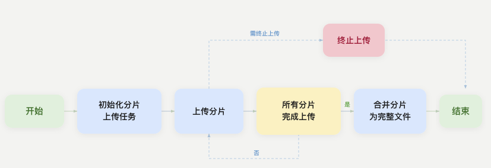

大文件上传面临网络中断风险和传输时间过长的挑战。分片上传通过将文件分割为多个小分片并发传输，提供断点续传能力和传输性能优化，有效应对网络不稳定环境下的文件传输需求。本文将详细介绍如何实现大文件分片上传能力，后续博文将介绍如何实现断点续传能力。

## 1. 工作原理

分片上传将大文件分割为多个小分片进行独立处理，各分片独立传输和校验，单个分片失败时仅需重传该分片，避免重新上传整个文件。分片上传使用 Upload ID 作为任务标识符，确保所有分片正确归属于同一个上传任务。核心流程分为三个步骤：
- 初始化上传任务：调用 createMultipartUploadAsync 创建分片上传任务，获取唯一的 Upload ID 作为后续操作的标识符。
- 上传文件分片数据：将文件切分为多个分片（Part）并发上传，每个分片大小在 5MB 到 5GB 之间，，分片总数不超过 10000。
- 合并分片完成上传：调用 completeMultipartUploadAsync 将所有分片按序号合并为完整的对象文件。



## 2. 扩展 Minio SDK 客户端

如果你打开 `io.minio.MinioAsyncClient`，会发现官方对外的分片能力几乎都是黑盒——它提供了一个 `uploadObject` 帮你自动分片，但 **底层协议方法大多是 `protected`**，外部无法直接调用：
- `uploadPartAsync(...)` —— `protected`
- `abortMultipartUploadAsync(...)` —— `protected`
- `createMultipartUploadAsync(...)` / `completeMultipartUploadAsync(...)` / `listPartsAsync(...)` —— 可见但仍不便组合使用

动手实现的价值就在于 **自己编排这套生命周期**。

### 2.1 Maven 依赖

首先需要添加 minio 的依赖：
```xml
<dependency>
    <groupId>io.minio</groupId>
    <artifactId>minio</artifactId>
    <version>8.5.14</version>
</dependency>
```

### 2.2 自定义客户端实现

扩展 Minio SDK 客户端最干净的做法是自定义一个客户端继承 SDK 客户端，把需要的能力提升可见性并复用（注意与实现类同包，即可访问 `protected` 方法）：
```java
/**
 * 功能：自定义扩展 Minio Client
 *      扩展 MinioAsyncClient 主要为了解决部分分片上传方法为 protected 无法调用的问题。
 * 作者：@SmartSi
 * 博客：https://smartsi.blog.csdn.net/
 * 公众号：大数据生态
 * 日期：2026/1/3 17:42
 */
public class MinioAsyncClient extends io.minio.MinioAsyncClient {
    /**
     * 包装一个已构建好的 SDK 异步客户端，复用其连接与凭证配置
     * 用途：以继承方式为同包实现类透出 SDK 中 protected 的分片上传方法
     * @param client 已配置好 endpoint 与凭证的 io.minio.MinioAsyncClient 实例
     */
    protected MinioAsyncClient(io.minio.MinioAsyncClient client) {
        super(client);
    }

    /**
     * 初始化分片上传，返回后续所有操作所需的 uploadId
     * 用途：分片上传生命周期第一步，向服务端登记一次上传任务并领取唯一 uploadId
     * @param bucketName       存储桶
     * @param region           区域(可选)
     * @param objectName       对象名
     * @param headers          消息头(可选)
     * @param extraQueryParams 额外查询参数(可选)
     */
    @Override
    public CompletableFuture<CreateMultipartUploadResponse> createMultipartUploadAsync(String bucketName, String region, String objectName, Multimap<String, String> headers, Multimap<String, String> extraQueryParams) throws InsufficientDataException, InternalException, InvalidKeyException, IOException, NoSuchAlgorithmException, XmlParserException {
        return super.createMultipartUploadAsync(bucketName, region, objectName, headers, extraQueryParams);
    }

    /**
     * 上传单个分片，返回该分片的 ETag
     * 用途：分片上传生命周期第二步；并发场景下每个分片应使用独立的 RandomAccessFile 并各自 seek 到起始偏移
     * @param bucketName       存储桶
     * @param region           区域(可选)
     * @param objectName       对象名
     * @param data             分片数据(RandomAccessFile 或 InputStream)，SDK 从当前指针读取 length 字节
     * @param length           分片数据长度
     * @param uploadId         上传ID
     * @param partNumber       分片编号(从 1 开始)
     * @param extraHeaders     额外消息头(可选)
     * @param extraQueryParams 额外查询参数(可选)
     */
    @Override
    protected CompletableFuture<UploadPartResponse> uploadPartAsync(String bucketName, String region, String objectName, Object data, long length, String uploadId, int partNumber, Multimap<String, String> extraHeaders, Multimap<String, String> extraQueryParams) throws InsufficientDataException, InternalException, InvalidKeyException, IOException, NoSuchAlgorithmException, XmlParserException {
        return super.uploadPartAsync(bucketName, region, objectName, data, length, uploadId, partNumber, extraHeaders, extraQueryParams);
    }

    /**
     * 完成分片上传，将各分片合并为完整对象
     * 用途：分片上传生命周期最后一步；parts 须按 partNumber 升序且携带各分片 ETag，否则合并失败
     * @param bucketName       存储桶
     * @param region           区域(可选)
     * @param objectName       对象名
     * @param uploadId         上传ID
     * @param parts            已上传分片列表(须按 partNumber 升序，含 ETag)
     * @param extraHeaders     额外消息头(可选)
     * @param extraQueryParams 额外查询参数(可选)
     */
    @Override
    public CompletableFuture<ObjectWriteResponse> completeMultipartUploadAsync(String bucketName, String region, String objectName, String uploadId, Part[] parts, Multimap<String, String> extraHeaders, Multimap<String, String> extraQueryParams) throws InsufficientDataException, InternalException, InvalidKeyException, IOException, NoSuchAlgorithmException, XmlParserException {
        return super.completeMultipartUploadAsync(bucketName, region, objectName, uploadId, parts, extraHeaders, extraQueryParams);
    }

    /**
     * 终止分片上传，丢弃该 uploadId 已上传的全部分片
     * 用途：上传失败或放弃续传时清理碎片，避免未完成分片长期占用存储产生费用
     * @param bucketName       存储桶
     * @param region           区域(可选)
     * @param objectName       对象名
     * @param uploadId         上传ID
     * @param extraHeaders     额外消息头(可选)
     * @param extraQueryParams 额外查询参数(可选)
     */
    @Override
    protected CompletableFuture<AbortMultipartUploadResponse> abortMultipartUploadAsync(String bucketName, String region, String objectName, String uploadId, Multimap<String, String> extraHeaders, Multimap<String, String> extraQueryParams) throws InsufficientDataException, InternalException, InvalidKeyException, IOException, NoSuchAlgorithmException, XmlParserException {
        return super.abortMultipartUploadAsync(bucketName, region, objectName, uploadId, extraHeaders, extraQueryParams);
    }

    /**
     * 列举指定 uploadId 下所有已经上传成功的分片
     * 用途：断点续传时查出已成功的 partNumber 与 ETag，以便跳过已传分片、仅补传缺失分片；合并所需的分片 ETag 也由此获得
     * @param bucketName       存储桶
     * @param region           区域
     * @param objectName       对象名
     * @param maxParts         单次返回的最大分片数(可选，上限 1000)
     * @param partNumberMarker 分片号标记，仅返回编号大于它的分片(可选，用于分页)
     * @param uploadId         上传ID
     * @param extraHeaders     额外消息头(可选)
     * @param extraQueryParams 额外查询参数(可选)
     */
    @Override
    public CompletableFuture<ListPartsResponse> listPartsAsync(String bucketName, String region, String objectName, Integer maxParts, Integer partNumberMarker, String uploadId, Multimap<String, String> extraHeaders, Multimap<String, String> extraQueryParams) throws InsufficientDataException, InternalException, InvalidKeyException, IOException, NoSuchAlgorithmException, XmlParserException {
        return super.listPartsAsync(bucketName, region, objectName, maxParts, partNumberMarker, uploadId, extraHeaders, extraQueryParams);
    }

    /**
     * 列举存储桶下所有进行中的分片上传任务：即已经初始化但尚未完成或者尚未被中止的分片上传任务
     * 用途：运维清理未完成的孤儿碎片(配合 Abort)，或在 uploadId 丢失时按前缀找回候选任务；注意它只到任务级，不返回分片 ETag
     * @param bucketName       存储桶
     * @param region           区域(可选)
     * @param delimiter        分隔符(可选)
     * @param encodingType     编码类型(可选)
     * @param keyMarker        对象键标记，从该键之后开始列举(可选，用于分页)
     * @param maxUploads       单次返回的最大上传任务数(可选)
     * @param prefix           对象键前缀过滤(可选)
     * @param uploadIdMarker   上传ID标记，从该 uploadId 之后开始列举(可选，用于分页)
     * @param extraHeaders     额外消息头(可选)
     * @param extraQueryParams 额外查询参数(可选)
     */
    @Override
    public CompletableFuture<ListMultipartUploadsResponse> listMultipartUploadsAsync(String bucketName, String region, String delimiter, String encodingType, String keyMarker, Integer maxUploads, String prefix, String uploadIdMarker, Multimap<String, String> extraHeaders, Multimap<String, String> extraQueryParams) throws InsufficientDataException, InternalException, InvalidKeyException, IOException, NoSuchAlgorithmException, XmlParserException {
        return super.listMultipartUploadsAsync(bucketName, region, delimiter, encodingType, keyMarker, maxUploads, prefix, uploadIdMarker, extraHeaders, extraQueryParams);
    }
}
```

构建客户端时包一层即可：
```java
MinioAsyncClient client = new MinioAsyncClient(MinioAsyncClient.builder()
        .endpoint("http://localhost:9000")
        .credentials("ACCESS_KEY", "SECRET_KEY")
        .build());
```

## 3. 实现大文件分片上传

> [源码](https://github.com/sjf0115/minio-example/blob/main/minio-quick-start/src/main/java/com/example/upload/MultipartUpload.java)

### 3.1 整体骨架

`uploadFile` 是整场上传的「总指挥」：它不亲自搬运一个字节，而是把三个协议调用按顺序编排起来——**成功时把分片合并成完整对象，合并失败时尽力清理已上传的碎片**。动手写代码前，先约定：
- **前置校验**：非普通文件（目录 / 不存在）直接拒绝；`fileSize == 0` 的空文件没有切片意义，应改走 `putObject`，否则会凭空产生一个只有 `uploadId`、却没有分片的「空上传任务」。
- **异常分层**：三步各自 `try/catch`，异常信息里点明「是在哪一步失败的」便于定位；只有可能已经堆出碎片的阶段（合并失败）才触发 `abort` 清理。

```java
public ObjectWriteResponse uploadFile(String bucket, String region, String object, String filename) {
    File file = new File(filename);
    if (!file.isFile()) {
        throw new IllegalArgumentException(filename + " 不是一个有效的文件");
    }
    long fileSize = file.length();
    if (fileSize == 0) {
        throw new IllegalArgumentException("空文件不适用分片上传，请改用 putObject");
    }

    // 步骤 1：初始化分片上传，获取 uploadId
    String uploadId;
    try {
        InitiateMultipartUploadResult result = minioClient
                .createMultipartUploadAsync(bucket, region, object, null, null)
                .get()
                .result();
        uploadId = result.uploadId();
    } catch (Exception e) {
        throw new RuntimeException("初始化分片上传失败", e);
    }

    // 步骤 2：并发上传所有分片
    Part[] parts;
    try {
        long partSize = calculatePartSize(fileSize);
        int partCount = (int) ((fileSize + partSize - 1) / partSize);
        parts = uploadParts(bucket, region, object, file, uploadId, partSize, partCount);
    } catch (Exception e) {
        throw new RuntimeException("并发上传所有分片失败", e);
    }

    // 步骤 3：完成分片上传，按分片号合并为完整对象
    try {
        return minioClient
                .completeMultipartUploadAsync(bucket, region, object, uploadId, parts, null, null)
                .get();
    } catch (Exception e) {
        // 无断点续传能力：失败即取消并清理碎片，避免残留占用存储
        minioClient.abortMultipartUploadAsync(bucket, region, object, uploadId, null, null).get();
        throw new RuntimeException("分片上传失败，已清理碎片, uploadId:" + uploadId, e);
    }
}
```

把 `uploadFile` 拆开看，它其实只做了三类事：
- **领取任务号**：调用 `createMultipartUploadAsync` 拿到 `uploadId`。此后所有分片都挂在这个 ID 下，它是「同一次上传」的唯一凭证；拿不到 ID 说明任务尚未建立，也就无需清理。
- **并发搬砖**：先用 `calculatePartSize`定好分片大小，算出 `partCount`，再把切片、并发、重试、排序全部委托给 `uploadParts`，最终拿回一个 **按分片号升序、且每个都带好 ETag** 的 `Part[]`。
- **合龙交付**：把 `Part[]` 交给 `completeMultipartUploadAsync`，让服务端按序拼装成完整对象。此步一旦失败，服务端已经堆了不少分片碎片，因此立刻 `abortMultipartUploadAsync` 清理，再把原始失败原因抛出。

> 这里把 `abort` 挂在合并失败分支，是为了突出「成功→合并、合并失败→清理」这条主线。工程上更稳妥的做法是用一个 `try/finally` 统一兜底：只要没成功合并（含分片上传阶段失败）就清理碎片，避免残留。本文从简。

### 3.2 并发上传分片（重点）

如果说 `uploadFile` 是总指挥，`uploadParts` 就是真正干活的工头——**切片、并发调度、单片重试、结果排序** 四件事在这里汇合，也是全篇最容易写错的一段。带着四个问题来读代码：
- 文件怎么被切成大小合适、且最后一片不越界的分片？
- 靠什么把「并发数」稳稳压在可控范围？
- 单个分片失败，如何只重传它、而不牵连全局？
- 并发完成顺序是乱的，合并要求的「升序」从哪来？

```java
public Part[] uploadParts(String bucket, String region, String object, File file,
                          String uploadId, long partSize, int partCount) {
    long fileSize = file.length();
    List<CompletableFuture<Part>> futures = new ArrayList<>();
    AtomicInteger finished = new AtomicInteger(0);

    for (int partNumber = 1; partNumber <= partCount; partNumber++) {
        final long startPos = (long) (partNumber - 1) * partSize;                 // 分片起始偏移
        final long curPartSize = Math.min(partSize, fileSize - startPos);         // 最后一片可能不足
        final int partIndex = partNumber;

        // 提交到线程池并发上传，线程池大小即最大并发数
        CompletableFuture<Part> future = CompletableFuture.supplyAsync(() -> {
            for (int attempt = 1; attempt <= MAX_RETRY; attempt++) {
                // 关键：每个分片使用【独立】的 RandomAccessFile，保证并发线程安全
                try (RandomAccessFile raf = new RandomAccessFile(file, "r")) {
                    raf.seek(startPos);
                    UploadPartResponse response = minioClient
                            .uploadPartAsync(bucket, region, object, raf, curPartSize,
                                    uploadId, partIndex, null, null)
                            .get();
                    finished.incrementAndGet();
                    return new Part(partIndex, response.etag());
                } catch (Exception e) {
                    LOG.warn("分片 {} 第 {}/{} 次上传失败: {}", partIndex, attempt, MAX_RETRY, e.getMessage());
                    sleepBackoff(attempt);   // 指数退避后重试
                }
            }
            throw new CompletionException(new RuntimeException("分片 " + partIndex + " 上传失败，已重试 " + MAX_RETRY + " 次"));
        }, executor);
        futures.add(future);
    }

    // 等待全部完成；任一分片最终失败则整体失败并尽力取消未完成任务
    List<Part> allParts = new ArrayList<>();
    try {
        CompletableFuture.allOf(futures.toArray(new CompletableFuture[0])).join();
        for (CompletableFuture<Part> future : futures) {
            allParts.add(future.join());
        }
    } catch (CompletionException e) {
        futures.forEach(f -> f.cancel(true));
        throw e;
    }

    // CompleteMultipartUpload 要求分片按 partNumber 升序排列
    allParts.sort(Comparator.comparingInt(Part::partNumber));
    return allParts.toArray(new Part[0]);
}
```

对应上面四个问题，逐条拆解：
- **切片数学**：`partNumber` 从 **1** 开始（S3 协议规定，不是 0）。第 n 片的起点 `startPos = (n-1) * partSize`；实际大小 `curPartSize = min(partSize, fileSize - startPos)`——这里的 `min` 正是为兜住 **最后一片往往不足一个 partSize**，同时保证不读越界。
- **并发怎么被限流**：`for` 循环体只做一件便宜事——把每个分片包成 `CompletableFuture.supplyAsync(..., executor)` **提交** 出去，真正的上传发生在池内线程里。线程池是固定大小 `CONCURRENCY`，所以无论提交多少个任务，同时在传的分片数恒 ≤ 池大小。这就是「**先全部提交、由线程池限流**」：提交速度与执行速度解耦。
- **失败只重传单片**：重试循环 `for (attempt ...)` 写在 **每个分片自己的任务里**，退避后重试；一片失败不影响别片，更不必重头传整个文件——这正是分片上传相较整文件上传的核心红利。超过 `MAX_RETRY` 才让该任务以 `CompletionException` 收尾。
- **等待与快速失败**：`allOf(...).join()` 阻塞直到所有分片结束；一旦有分片最终失败，`join()` 抛 `CompletionException`，此时 `cancel(true)` 尽力取消其余尚未完成的任务，避免继续做无用功。
- **升序从哪来**：任务 **完成顺序 ≠ 提交顺序**，收集到的 `allParts` 是乱的；而 `CompleteMultipartUpload` 要求按 `partNumber` 升序，所以最后必须 `sort(Comparator.comparingInt(Part::partNumber))`。每个 `Part` 由「分片号 + 该分片上传响应里的 ETag」构成，服务端合并时正是靠它来定位每个分片。

## 4. 核心策略

### 4.1 分片大小策略：5MB / 5GB / 10000 的取舍

分片大小不是拍脑袋定的，而是协议约束「夹」出来的：
```java
private long calculatePartSize(long fileSize) {
    long partSize = MIN_PART_SIZE;                                   // 从 5MB 起步
    while ((fileSize + partSize - 1) / partSize > MAX_PART_COUNT) {  // 分片数超过 10000 就增大
        partSize *= 2;
    }
    return Math.min(partSize, MAX_PART_SIZE);                        // 5GB 封顶兜底
}
```

设计逻辑一句话：**从最小值起步，只有被逼无奈才增大。**
- **为什么从 5MB 起步（下限）**：5MB 是协议允许的最小分片，也是性能平衡点。分片越小、切得越细，并发度和断点续传粒度越好；而 5MB 又能避免请求数过多带来的网络往返与请求开销。所以取「满足约束的最小值」。
- **为什么要倍增（10000 上限）**：`fileSize / partSize` 是分片数。当文件大到用 5MB 切会超过 10000 片时，就 **成倍放大分片大小** 直到分片数不超上限。用 `×2` 是因为实现简单、循环 `log₂` 级别快速收敛。`(fileSize + partSize - 1) / partSize` 是 **向上取整**。
- **为什么 5GB 封顶（上限兜底）**：单片协议上限就是 5GB，`Math.min` 是防御性保护。

> 三者组合的本质：大小 ∈ [5MB, 5GB] 且数量 ≤ 10000，正好对应 `10000 × 5GB = 48.8TB` 的单对象上限。

### 4.2 为什么用 `RandomAccessFile`，而不是 `InputStream + BoundedInputStream`

很多参考实现（包括处理 `MultipartFile` 的场景）会这样写单个分片：
```java
try (InputStream is = new FileInputStream(file)) {
    is.skip(startPos);
    BoundedInputStream boundedInputStream = new BoundedInputStream(is, curPartSize);
    // 用 boundedInputStream 上传分片 ...
}
```
看似等价，实则内存占用与可靠性都差了一截。**结论：上传本地文件时 `RandomAccessFile` 严格更优。**

- 内存：深入 SDK 源码（`PartReader`）可以看到两条截然不同的路径，整片进堆 vs 流式读盘
  - 传 `InputStream` → SDK 会把 **整个分片读进内存缓冲** `ByteBufferStream`。而 `ByteBufferStream extends ByteArrayOutputStream`，就是 **堆上的字节数组**。更关键的是分块常量 `CHUNK_SIZE = Integer.MAX_VALUE`（约 2GB），意味着 ≤2GB 的分片会被 **整片塞进一个内存缓冲**。并发 5 × 5MB 尚可接受，但当分片被放大到 GB 级时，堆内存直接被撑爆 → **OOM**。
  - 传 `RandomAccessFile` → SDK 只用一个 **16KB 缓冲** 流式计算 sha256，随后把文件指针 `seek` 回原位；HTTP 发送时通过文件通道 `Channels.newInputStream(file.getChannel())` **直接从磁盘流式读取**，全程不整片入堆。
- `BoundedInputStream` 治标不治本
  - `new BoundedInputStream(is, curPartSize)` 的作用只是「限制最多读 `curPartSize` 字节」。它 **并不能阻止** SDK 把这 `curPartSize` 字节缓冲进内存——是否缓冲由 SDK 内部对 `data` 类型的处理决定，与外面包没包 BoundedInputStream 无关。
- 定位精度：`seek` 精确 vs `skip` 不可靠
  - `InputStream.skip(n)` 的方法契约 **并不保证** 恰好跳过 `n` 字节（允许少跳），严谨使用需要自己循环补跳；用它来定位分片起点是脆弱的。`RandomAccessFile.seek(pos)` 则是**精确定位**，天然契合「按偏移切分文件」。
- SDK 对分片数据会「读两遍」
  - 上传一个分片，SDK 会先读一遍算 sha256（V4 签名需要），HTTP 发送正文时再读一遍。文件句柄可以 `re-seek` 重读，零内存成本；而 **流不可重读**，只能先把整片缓冲下来——这正是 `InputStream` 路径必须占内存的根因。
- 那什么时候该用 `InputStream`？
  - 当数据源 **根本不是本地文件**、拿不到可随机访问的 `File` 时，只能用 `InputStream`，例如：
    - Web 上传的 `MultipartFile`（HTTP 请求流）；
    - 来自网络、管道、`byte[]` 的数据。

> 顺带一提：并发安全两种方案都能做到——各自为每个分片开 **独立句柄** 即可。所以线程安全不是二者的区别点，**内存效率 + 定位精度 + 可重读性** 才是选择 `RandomAccessFile` 的真正理由。

## 5. 最佳实践

- **小文件别分片**：几 MB 直接 `putObject`，分片反而更慢。
- **分片别小于 5MB**：除最后一片外，小于 5MB 会在合并时报 `EntityTooSmall`。
- **合并前一定按 `partNumber` 升序排序**：否则 `CompleteMultipartUpload` 会失败或结果错乱。
- **并发数不是越大越好**：过高并发会抢带宽、加剧小片缓冲内存；需结合网络与机器负载调优（示例取 5）。
- **务必处理碎片**：失败要么 `AbortMultipartUpload` 清理，要么配置桶的**生命周期规则**自动回收未完成分片，避免长期占用存储产生费用。
- **上传本地文件优先用 `RandomAccessFile`**：内存友好、定位精确、可重读；只有 `MultipartFile`/网络流才用 `InputStream`。
- **每个分片独立文件句柄**：并发下绝不能共享 `RandomAccessFile`，否则 `seek` 互相踩踏。
- **重试要有退避与上限**：避免瞬时故障下高频重试打爆服务端。

## 6. 总结

本文从「为什么分片」出发，梳理了 MinIO 分片上传的完整生命周期与协议约束，落地了一套**并发上传 + 失败重试 + 自动分片 + 失败清理**的可用实现，并深入剖析了几个关键工程决策：
- 为什么必须自定义客户端暴露 SDK 的 `protected` 分片接口；
- 为什么用 `RandomAccessFile` 而非 `InputStream + BoundedInputStream`（内存 / 定位 / 重读）；
- 分片大小 `5MB → ×2 → 5GB` 背后的协议取舍；

分片上传的威力不止于「传得动大文件」，更在于把一次脆弱的大传输，拆成许多**可并发、可重试、可续传**的小单元。掌握这套生命周期与取舍，你就能应对网络不稳定环境下的各种大文件传输需求。
